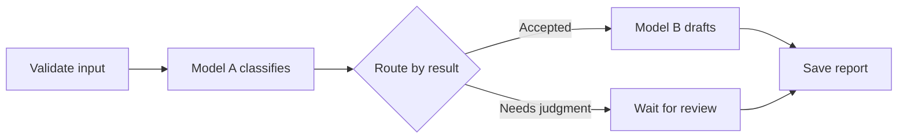

# CookBook

**Write the recipe with an agent. Run it from an app, a schedule, or a single MCP call.**

CookBook is a local Rust runtime for repeatable workflows. Use Codex or Claude Code to turn a task you’ve solved into a versioned **recipe**. Chain scripts, APIs, MCP tools and different models in one run. CookBook handles branches, parallel batches, review handoffs and run history, and can return just the counts and a link to the full report.

Think n8n-style workflow automation with recipes your agent writes and a runtime you run locally. The source includes a loopback relay prototype that queues jobs while the CookBook worker is offline.

[Try the demo](#try-the-demo) · [Connect your agent](#connect-your-agent) · [Chain models](#chain-models-in-one-recipe) · [Relay prototype](#queue-jobs-for-an-offline-worker) · [Benchmarks](#what-we-measured)

## How it works

1. **Solve it once.** Work through an example with your agent and verify the result. Ask it to save the repeatable steps as a CookBook recipe.
2. **Run the saved version.** Pass in a new batch from a client, start it in the inspector, or set a [schedule](docs/runbooks/scheduled-jobs.md). Local rules and scripts can finish with zero model tokens. One call can handle a batch with bounded parallel workers.
3. **Read the result.** Get a compact result and a reference to the full artifact. Inspect what ran, which recipe version it used, and where it paused. If the recipe needs judgment, it can wait for the caller to submit an explicit result.

For example, give a recipe a batch of records to check and get back three counts and a saved report. The included [inventory and ticket SLA examples](examples/operation-reports/README.md) show this pattern end to end with synthetic data.

## Chain models in one recipe

A recipe can call different models at successive steps through approved API or MCP connections. Each step maps the inputs it needs and passes a validated result downstream. For example, one model can classify a batch, a second can draft the accepted items, and a local rule can send uncertain cases to review before the recipe saves its final report.



Optional **Jev** adds structured decision questions and routing. Direct model API steps work with approved connections and their own usage limits. The default build can run the demo and local recipes without an inference account. [Model and MCP connections](integrations/knowledge/connections.md) · [Jev example](examples/jev-intake/process.json)

## Try the demo

On macOS or Linux, install Git, [rustup](https://rustup.rs/), the platform’s C compiler and linker, and Python 3.11 or newer. The repository pins the Rust version. Run these commands on the machine where you want to use CookBook.

```sh
git clone https://github.com/miguelfem/cookbook.git
cd cookbook
cargo build --locked -p apr-cli
python3 tools/try_local.py
```

The launcher starts the local inspector with disposable sample data. Open **Run history**, choose a waiting review and submit a decision to produce a ZIP artifact. It runs without an API key or an agent connection. [Demo walkthrough](docs/runbooks/local-demo.md)

## Connect your agent

1. **Build the desktop preview.** On Apple Silicon macOS, install Node.js with npm and the Xcode command-line tools. From the cloned repository, run:

   ```sh
   python3 -m venv .venv
   .venv/bin/python tools/build_desktop_local.py
   ```

   Open the resulting DMG and drag **CookBook APR** to Applications. [Build prerequisites and optional Jev build](docs/runbooks/local-verification.md#build-a-development-installer)
2. **Install the MCP connection.** In CookBook, open **Settings & access → Connect your agent**, select **Codex** or **Claude Code**, preview the setup and click **Connect agent**. Start a new task in the project where you want to use it.
3. **Verify your first recipe.** Ask the agent: “Use CookBook in this project. Check that its MCP tools are available, create and run the save-note starter, and show me the saved result.” Once it works, give the agent a task you actually repeat.

For background execution, use [scheduled jobs](docs/runbooks/scheduled-jobs.md) or call `apr_run` directly from a client that already has the recipe and inputs. The [direct report helper](tools/direct_report.py) shows how to display counts and an authorized report link without starting a model turn. [Manual MCP setup](docs/runbooks/client-integration.md) · [First-project walkthrough](docs/runbooks/first-project.md)

## Queue jobs for an offline worker

The [relay prototype](tools/evals/benchmark_standalone_relay.py) accepts jobs over HTTP and persists them until a CookBook worker can claim them. In the simulated outage, the relay accepted work while CookBook was stopped, kept the job through a relay restart, and recovered from a lost acknowledgement with one recipe execution.

The prototype runs on loopback with synthetic data. A VPS-hosted relay is a proposed deployment. [Outage test and deployment design](docs/evaluations/2026-11-19-fresh-threads-and-standalone.md#model-free-schedule-and-relay)

## What we measured

- **Direct typed MCP execution** returned 12/12 exact synthetic results with zero model tokens. Median call times ranged from 0.10 to 0.89 seconds after connection and input staging.
- **Standalone scheduling** completed 4/4 exact 300-row reports with zero model tokens. The median was 314 ms from due time to recorded success.
- **Execution through Codex** used about the same input tokens as Codex working from raw inputs in a 12-pair test. Both made 27 model requests. The most dependable way to keep repetitive work out of the model context was to run the recipe directly.

[Direct and scheduled benchmarks](docs/evaluations/2026-11-19-fresh-threads-and-standalone.md) · [Raw-input comparison](docs/evaluations/2026-11-19-saved-recipes-vs-raw-codex.md) · [All evaluations](docs/evaluations/README.md)

## Source and credits

[Documentation](docs/INDEX.md) · [Architecture](docs/architecture/runtime.md) · [Contributing](CONTRIBUTING.md)

CookBook adapts code from **typesafe-computer-use** by Aaron Levin and **OpenClaw Lobster**. CookBook’s own project license is undecided. The credited upstream code and dependencies keep their applicable licenses and notices. [Credits](CREDITS.md) · [Third-party notices](THIRD_PARTY_NOTICES.md)
