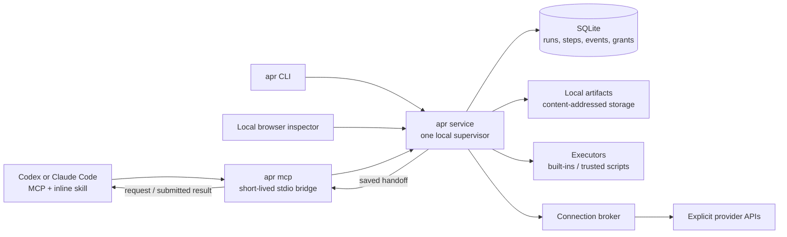

# Runtime architecture

Design v0.1, 2026-09-14. This document owns implementation boundaries and recovery behavior. See [protocol](protocol.md) for wire contracts and [security](security.md) for authority.

The 2026-09-16 [routing extension](workflow-routing.md) uses manifest 0.2 for decisions, branches, joins and child processes. [Execution](execution.md) describes the implemented Python, HTTP and optional Jev paths. The concrete completion plan and validation log distinguish these implementations from broader future designs below.

## Components

### Implemented core and service boundary

The seven-crate workspace is running: `apr-core` admits manifests and resolves data bindings; `apr-runtime` owns SQLite, artifacts, attempts, handoffs, receipts, scope and service; `apr-cli` exposes owner commands and transport entry points; `apr-mcp` uses the official Rust SDK for the agent-facing tools. See the [CLI walkthrough](../runbooks/local-cli.md), [scoped MCP setup](../runbooks/client-integration.md), and [runtime validation](../logs/runtime-validation.md). `apr-connectors` implements bounded HTTP and protected credentials; `apr-provider-jev` is an optional wire adapter; `apr-integrations` owns managed client settings. The local browser inspector is bundled with the CLI.

APR uses one private state directory (default `.apr/local`) with SQLite WAL, foreign keys, `synchronous=FULL`, transactional migration version 9, and an exclusive OS file lock per control operation or scheduling quantum. This lock is the serial executor lease: termination releases it. Attempt identities and monotonically increasing fences are checked within completion transactions. Scheduled jobs add persisted UTC triggers and atomic occurrence creation; see [scheduled jobs](scheduled-jobs.md). The service owns one scheduler thread; there are no independent worker leases yet. Each filesystem publication completes before its SQLite reference commits; a killed process may leave an unreferenced object, never a deliberately committed partial object. Migration from the original version 1 preserves legacy run identity, events, artifacts and result receipts.

Process source is snapshotted as canonical JSON in `process_versions`. Version identity is SHA-256 of `apr-json-v1`, a zero byte, and the canonical bytes. Object keys are sorted; array order and the pinned Serde number/string representation are preserved. This is not RFC 8785. `float_roundtrip` preserves numeric identities on reload. Artifacts use raw SHA-256 of bytes, independently of the process encoding.

Supported steps are five pure builtins, caller-performed `agent` steps, trusted Python scripts, bounded JSON connectors, and manifest 0.2 decision/join/call controls. Keyed foreach expands builtins, scripts, connectors, agent steps and child calls within explicit limits. Recursive schemas, external schema references, arbitrary expressions and unsupported executor kinds fail admission. Configuration and script source snapshots are immutable per accepted run; credentials remain protected references. A review or approval uses an explicit caller handoff; there is no separate approval executor.

Pending handoffs persist across command exits. Tokens expire after 24 hours and live in private files; SQLite stores hashes. `renew` explicitly rotates generation/token without issuing another agent request. Result receipts bind run, request, step, generation, output, and provenance, excluding the transport token. Matching receipts are checked before consumed-token validation. Terminal runs cannot be revived by an outstanding handoff.

The CLI is trusted local owner control. MCP operations require an opaque attachment credential bound to one assignment and author/run mode. A registered project is bound to its canonical path and directory device/inode, so a replacement folder cannot inherit authority. Direct-ID access, catalog visibility, artifact use, and result submission recheck the assignment. Imported artifacts belong to the importing assignment; equal content hashes alone confer no access. Managed paths reject traversal, symlinks, hardlinks, and the runtime state subtree. Attachment files stay inside that protected state directory.

The service starts on demand in a separate process group with null standard streams. Startup uses Rust's standard process-group option without a pre-exec callback; termination of the launcher's group leaves the supervisor running. This is process-group isolation, not a separate login session. A permanent lock inode elects one supervisor, and a short socket under a private `/tmp/apr-<uid>/<state-path-hash>/` directory avoids Unix path-length failures. The wire uses one bounded newline JSON request per connection, protocol version and request identity checks, absolute read deadlines, at most 32 active clients and 32 queued requests. The worker queues a start before background dispatch. It advances at most one step per selected run per quantum, releasing the runtime lock between runs. A disconnected client does not withdraw accepted work. SIGTERM/SIGINT stop at the next dispatch boundary; a new service discovers saved runnable work.

Attachment grants expire after 30 days and can be revoked through owner control. Revocation denies further calls without cancelling already accepted independent work. Closing an assignment cancels its nonterminal runs. A temporarily unavailable or replaced project blocks work; restoring the registered directory and explicitly continuing preserves completed steps.

Inline JSON inputs/results are capped at 64 KiB; larger data belongs in artifacts. Transport responses default to 8 KiB, with explicit detail capped at 64 KiB. Discovery descriptors and variable handoff payloads are limited to 48 KiB, reserving identity/wrapper overhead. Omitted data is marked, and handoff input/schema/token fields are never partially returned as an actionable request. Artifact sizes are bounded per operation and ZIP budgets include metadata. Declared media types are immutable once registered, but APR does not sniff or decode file contents. `max_step_ms` rejects an over-time result before commit; synchronous file operations are not forcibly preempted. Managed artifact quotas and explicit retention cover immutable objects. Native worker cancellation kills and reaps its process group. The quota excludes SQLite, temporary staging and trusted code’s arbitrary filesystem writes; it is not a disk sandbox. Stronger native isolation remains separate work.

### Service architecture



The service owns scoped runs, not the stdio child. The bridge translates MCP to the internal API and executes no workflow steps itself. Current owner CLI commands also support synchronous local operation under the same storage lock. Routing all future CLI/inspector commands through scoped service methods remains the target.

The system is local and single-user in the preview. There is no network listener by default. Use a Unix-domain socket with local-user permissions on macOS/Linux. A Windows named-pipe transport is deferred. A locked service lease prevents two supervisors using the same state store. Startup races retry connecting to the winner.

The service starts on demand. Graceful shutdown stops scheduling new work, persists state, and resolves/terminates workers according to their effect policy. While an independent run is active the service stays alive. Auto-start after login is an explicit installation option, not a promise that a stopped machine keeps working.

## Module boundaries and possible future extraction

| Module / possible later crate | Owns |
|---|---|
| `apr-core` | Pure domain types, manifest validation, transition rules, error taxonomy |
| `apr-store` | SQLite migrations, transactions, event journal, artifact metadata |
| `apr-engine` | Scheduler, leases, attempts, recovery, bounded expansion |
| `apr-exec` | Built-in operations and executor protocol |
| `apr-connect` | Connection broker, credential-store interface, operation policies |
| `apr-server` | Local IPC, attachment checks, service lifecycle |
| `apr-mcp` | MCP schemas, handlers, output budgets, notifications |
| `apr-cli` | Installation, diagnostics, author/run commands, secure local prompts |
| `apr-desktop` | Optional Tauri shell over the internal API, added after core gates |

Start with `apr-core`, `apr-runtime`, and `apr-cli`. The store, engine, executors, broker, and service begin as internal modules of `apr-runtime`; the table names their responsibilities rather than requiring nine crates immediately. Add `apr-mcp` during client integration and separate other crates when an actual dependency or ownership need warrants it. Core must not depend on MCP, Tauri, a particular provider, or a client session interface. The optional Jev adapter is registered at the executable composition root under the [decision-provider contract](decision-providers.md).

Pinned dependencies include Serde/Clap, official `rmcp`, `rusqlite` with bundled SQLite 3.51.3, `jsonschema`, `ureq` with rustls, and `keyring` behind the credential-store interface. Synchronous dispatch uses one writer plus a separate read connection; both observe the same SQLite WAL. Never open and close a raw descriptor for an active database file: POSIX close can release unrelated SQLite advisory locks in the same process.

Rust 1.94.0, selected dependency versions/features, and Cargo.lock are now pinned. The validation log records the tested combination; additions below remain proposed interfaces until implemented.

## Module interfaces

These proposed interfaces define testable seams; exact Rust signatures are settled with the implementing work package. Callers should not reproduce the hidden rules in their own wrappers.

| Module | Small interface | Behavior kept inside |
|---|---|---|
| Admission | Validate a draft; admit an immutable supported plan | Parsing, schemas, supported-feature checks, reference/type analysis, finite graph/effect rules, digest construction and bundle integrity |
| Catalog | Discover bounded matches; describe/register a selected version | Authorized visibility, version identity, metadata/search indexing, and registration atomicity |
| Run control | Start, inspect, and request a legal transition under an authenticated context | Scope, preflight, frozen configuration, deduplication, result receipts, state/revision checks, and actionable errors |
| Store | Commit named run/attempt/effect/receipt transactions; query scoped views | Migrations, uniqueness, revision/fencing checks, atomic event/accounting updates, and consistent snapshot support |
| Engine | Advance eligible saved work; recover interrupted work | Scheduling, leases, dependency readiness, fan-out, joins, budget reservations, cancellation, and retry/reconciliation selection |
| Artifacts | Import, publish, read bounded data, and maintain retention references | Path/size/type checks, immutable copies, hashes, atomic publication, provenance and garbage-collection safety |
| Executors | Execute one typed bounded attempt; report completion, wait proposal, or failure | Built-in or trusted-worker mechanics; the engine commits waiting states and issues continuation material |
| Connections | Execute/reconcile a declared operation through a named binding | Credential resolution, destination/resource checks, provider transport, known effect evidence, and bounded I/O |
| Client adapters | Install/diagnose/remove owned settings; serve the common skill/tool contract | Client-specific config/trust/version behavior, preserving unrelated settings and explicit caller handoffs |

The CLI, MCP bridge, and inspector use run control and scoped queries, not raw database writes or parallel schedulers. The engine uses the same admission/policy types but never imports a client wrapper. External adapters receive operation context; they cannot bypass the store's intent/receipt/accounting transactions.

Important atomic groups are start + immutable references + deduplication key; attempt lease + fencing identity + capacity reservation; result + artifact links + usage/effect evidence + event; accepted handoff + receipt + step transition; and parent child-dispatch identity + child creation. Each has a crash/retry test in the [verification plan](../plans/verification.md). Network calls, subprocess execution, and user waits happen outside these transactions.

## Storage and ownership

Proposed macOS state root: `~/Library/Application Support/AgentProcessRuntime/`. Linux follows XDG state/data directories. Resolve these through platform APIs, not literal username paths.

Within the state root:

```text
state.sqlite3
objects/sha256/<digest>
versions/<digest>/             immutable admitted process bundle
workers/<run>/<step>/<attempt> temporary work areas
logs/                         bounded operational logs
ipc/                          private socket and local metadata
```

Project source contains `.apr/project.json`, `.apr/processes/`, schemas, fixtures, and dependency locks. The project file is a portable descriptor, not an authorization token. Local registration binds a canonical path and a local workspace instance. A clone or new worktree requires attachment; it does not inherit grants because it copied a project ID.

Database design:

| Table | Important fields / constraints |
|---|---|
| projects | local id, portable descriptor id, canonical root, workspace instance |
| assignments | project FK, label, status, limits, created/closed times |
| attachments | project/assignment FKs, client kind, correlation hint, token digest, expiry |
| process_versions | digest PK, schema version, immutable bundle path, capability digest |
| catalog_entries | scope, name, version FK, visibility; name unique within scope |
| runs | assignment FK, version FK, state, config snapshot, request key, revision |
| step_instances | run FK, step definition id, item key, state; unique run/step/item |
| attempts | step FK, attempt number, lease owner/deadline, outcome/effect classification |
| handoffs | step FK, expected schema digest, nonce digest, claim owner, generation, expiry |
| resume_receipts | run/step/generation/submission key, payload digest, accepted result |
| effects | operation id, idempotency key, provider reference, dispatch/outcome evidence |
| artifacts / artifact_links | digest, size, type, owner scope, provenance, retention |
| connections / grants | credential reference, revision, operation policy; no plaintext secret |
| events | monotonic cursor, scope, run revision, type, bounded payload |

Use foreign keys, WAL, a busy timeout, and transactional schema migrations. Treat durability settings explicitly: critical state/effect writes use a configuration that persists commits through process crashes and is tested under forced termination. SQLite transactions do not make external API effects atomic.

One writer actor serializes short transactions. No network call, subprocess wait, or model call runs inside a database transaction.

## Admitting a process

1. Resolve draft paths within the permitted project area. Reject traversal, symlinks escaping the allowed root, missing files, unbounded imports, and unsupported schema versions.
2. Validate JSON Schema plus semantic rules: unique step IDs, acyclic dependencies, valid bindings, one declared output contract, finite limits, and coherent effect/retry policy.
3. Copy admitted files into an immutable bundle. Hash the canonical manifest, which includes declared source paths and content digests. Verify and snapshot those source bytes; Python dependency-lock contents are not frozen by the current runtime. Exclude timestamps and local absolute paths. Reject unexpected files.
4. Bind the bundle to its requested capability set and fixtures. Validation evidence and permission grants are separate records.
5. Register its version in the chosen catalog only if the attachment can author there. Editing source later changes the version digest.

Use JSON for the first manifest format. A later YAML frontend may compile to the same contract, without arbitrary tags or expression evaluation.

## Executing a run

Preflight validates typed inputs, available artifacts, allowed overrides, capabilities, executor/connection availability, bounds, and process version. It is advisory: recheck grants before dispatch because revocation can occur afterward.

Starting a run is one transaction that resolves configuration, snapshots references, stores the deduplication key, and queues the initial steps. The same key and payload return the existing run; the same key with different payload is a conflict.

For each eligible step:

1. Claim a step lease and record an attempt before launching work.
2. Resolve immutable inputs and check current grants/budget.
3. Execute outside the transaction in a bounded worker or connector.
4. Stage artifacts in temporary files; hash, size-check, and atomically move them into the object store.
5. Commit output, artifact links, effect evidence, and step completion together.
6. Schedule newly eligible steps. Return only the final envelope or an actionable wait/error to the client.

Object writes can precede the database commit. Unreferenced objects are harmless and are reclaimed later; the engine must not commit references to missing objects. Imported files are copied/snapshotted, not trusted as mutable paths.

The DAG cannot depend on a future step. Bindings are data selectors: literal value, run input, earlier step output, or current item. They do not evaluate shell, Python, or JavaScript expressions.

## Expansion and long creative jobs

A bounded `foreach` expands a declared list after its producer commits. Each item requires a unique stable key and creates a separate step instance. Persist the complete expansion once, including item order and value digest. Retry and resume operate on an individual instance, not the whole loop.

Set maximum item count, concurrency, per-step duration, per-provider request count, artifact bytes, and retry budget. Large plans must be split deliberately; the agent cannot expand an unbounded request by omitting limits. Nested expansion and dynamically growing graphs are deferred.

A document-review process should checkpoint each accepted review independently. A single large “review every document” handoff loses too much granularity. Revisions to one review are either explicit child runs or bounded new attempts, with prior artifacts retained and costs counted.

## Executor contract

All executors receive a typed input file/message, run/step/attempt identity, artifact handles or materialized snapshots, remaining limits, and allowed host operations. They return typed output plus artifact declarations and bounded diagnostics.

- **Built-ins**: compiled, narrow operations such as artifact manifests, JSON validation, checksums, file packaging, and deterministic data transformations. No arbitrary command execution.
- **Trusted script**: explicit opt-in for reviewed local Python helpers. Pin the absolute interpreter and admitted source, prepare dependencies explicitly outside APR, pass argv without a shell, clear inherited environment, bound I/O, and supervise a separate process group. These controls are hygiene, not sandbox confinement.
- **Connector**: broker executes an allowed named operation using a connection binding. Models/generated code do not receive credential values.
- **Agent**: persists a handoff and exits the worker; it never waits with a Python stack or Rust future as the only record of progress.
- **Future approval executor**: not admitted today. A review can use a caller handoff, but a model cannot approve an authority expansion on behalf of the user.

The executor protocol should remain versioned and serializable so later isolated JS/Wasm workers can implement it. Do not introduce arbitrary code execution into the connection broker.

## Recovery and effect safety

At startup, inspect expired attempts and outstanding effects. Use conservative classification:

| Situation | Recovery |
|---|---|
| Queued step | Schedule normally after current policy check. |
| Completed step with valid artifacts | Reuse its committed result; never rerun just because the client disconnected. |
| Interrupted pure step | Retry within budget using the same immutable inputs. |
| Interrupted non-idempotent script | Mark uncertain or failed for manual inspection; do not infer purity from its name. |
| Future asynchronous provider action | Requires a separately implemented polling contract; current connectors are bounded synchronous operations. |
| Action may have succeeded but response was lost | `needs_reconciliation`; reuse downstream idempotency key only if provider semantics support it. |
| Saved agent request | Remains waiting; inspect or explicitly renew under the authorized attachment. |
| Missing/corrupt artifact | Block dependent steps with an integrity error. |

Persist intent before dispatch. When supported, send a provider idempotency key derived from run, step instance, and logical operation, **stable across transport retries**. A new deliberate operation uses a new logical identity. Respect provider key-retention limits.

A local retry counter is not proof that a request did not execute. A provider without a query/idempotency contract requires human or domain-specific reconciliation. Cancellation prevents new dispatch but cannot recall an already accepted remote action.

## Handoff lifecycle

Commit the request, expected schema digest, item identity, and generation before returning `waiting_for_agent`. Completion tokens are random scoped capabilities stored as digests; they allow submission to one step/generation, not arbitrary execution or artifact reading.

To accept a result, authenticate the attachment and check scope, then look for an existing receipt. A matching submission key and semantic payload returns that receipt even if its old token is now consumed. A conflicting payload fails. Only a new submission proceeds through current token/claim generation, result schema, and artifact ownership/integrity checks before a transactional commit. Commit the receipt before acknowledging.

The semantic payload digest covers run/request/step/generation, output, and provenance. It excludes transport credentials and receipt timestamps. This permits a legitimate retry after reconnect without turning credential rotation into a different creative result.

If a connection disappears, retain the handoff. Reattachment can claim it after an explicit transfer or lease expiration. Expiry does not silently rerun creative work: inspect/import already produced results before authorizing another attempt.

No automatic ownership transfer on a chat title, cwd, MCP roots hint, or client session string. Those are correlation aids only.

## Cache and resource behavior

M0/M1 reuse completed steps within a run, not a general cross-run cache. Add cross-run caching only for declared pure operations with a key covering version, inputs, config, executor/dependencies, and relevant context. Never automatically cache or replay external side effects as if they were pure transformations.

Results and logs have explicit byte caps with truncation metadata. Logs are not result data; store large structured outputs as artifacts. A producer exceeding its limit is stopped or rejected with an actionable error.

Backpressure limits queued work and total artifact growth. Garbage collection follows artifact links, run retention, and active exports, with a grace period. It must never collect a referenced pending-run input.

## Installation and upgrade

The source repository is public. Distribute signed/checksummed core executables and explicitly selected optional packages once the release gates pass. Default packages omit Jev. License selection, dependency redistribution, artifact verification, and signing ownership are explicit tasks in the [implementation plan](../plans/implementation.md); public source availability is not a tested binary release.

The CLI should diagnose platform, binary resolution, service health, storage permissions, client config, and required executors without exposing secrets. An old bridge must refuse an incompatible service protocol cleanly.

For state migrations, acquire exclusive ownership, stop new dispatch, back up consistently, apply forward migrations transactionally, and verify before restarting. Rollback of the binary does not imply automatic rollback of the database schema.

Cross-device run migration is deferred. Its design requires an exported paused snapshot, artifact hashes, process bundle, schema version, explicit source relinquishment, target ownership claim, and local credential rebinding. Git is sufficient for source handoff only.
