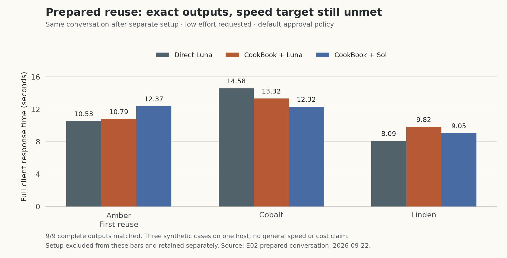

# E02: reuse inside a prepared conversation — 2026-09-22

All **9/9** held-out outputs exactly matched the complete frozen contract. Under
Codex's default approval policy, CookBook Luna took **33.937 s**, CookBook Sol
**33.744 s**, and direct Luna **33.208 s** across three cases. CookBook remained
2.2% and 1.6% slower in aggregate, respectively. **The first-reuse speed target
is still failed.** This small synthetic pilot establishes exact results and a
measured remaining delay; it does not establish a general speed or cost advantage.

The optional trusted-run arm was **not started**, pending explicit owner consent.
No approval intervals were subtracted to simulate its result.

Subsequent explicit consent enabled a separately frozen
[trusted-run diagnostic](2026-09-22-e02-trusted-prepared.md). This original report
and its contemporaneous blocked-arm record remain unchanged.

## What changed and what was measured

This development build keeps the earlier bounded one-call result delivery and
reduces repetitive MCP metadata. The fixed run tool list shrank from 14,705 to
12,566 minified JSON bytes (14.5%); initialization instructions shrank from 1,284
to 466 bytes by describing only the attachment's available authority. Every input
field, output limit, scope check, execution grant, source pin and effect annotation
remains. Original and compact schemas agreed on 1,620 acceptance/rejection cases,
including a valid witness for each of 61 inspect/resume/manage selectors. Metadata
bytes are not model tokens and do not prove a latency improvement by themselves.

Unlike the [previous fresh-session study](2026-09-22-e02-one-call.md), this study
kept one ephemeral app-server conversation per arm. Each first read the same
synthetic task contract and completed a development case. Only then did the three
new held-out reuse turns begin in that same conversation. The direct arm could
retain or create reusable code; it chose two source commands per holdout.
CookBook used one registered recipe and one `apr_run` per holdout, with no
inspection follow-up. Recipe registration, grants, service warm-up and the model
setup turn were outside reuse timing for every arm.

The task normalizes whitespace and currency, totals integer monetary values,
counts held items and returns both source evidence IDs in exact JSON, with no
extra fields. Cases, prompts, counterbalanced arm order, models, approval policy,
oracle and harness were frozen before model use. The separately authored oracle
was checked against the task rules and independently recalculated afterward;
it was **not human reviewed**. This is E02, not an E05 provenance pass.

## Observed results

All arms requested low effort on every turn. The actual model identities were
confirmed as `gpt-5.6-luna` and `gpt-5.6-sol`; effective per-turn effort was not
independently emitted by the client.

| Held-out reuse | Direct Luna | CookBook Luna, default | CookBook Sol, default |
| --- | ---: | ---: | ---: |
| Amber — first reuse | 10.532 s | 10.792 s | 12.373 s |
| Cobalt | 14.584 s | 13.325 s | 12.323 s |
| Linden | 8.092 s | 9.820 s | 9.048 s |
| **Total** | **33.208 s** | **33.937 s** | **33.744 s** |
| Exact complete outputs | 3/3 | 3/3 | 3/3 |
| Tool calls | 6 | 3 | 3 |
| Expected source reads | 6 | 6 | 6 |

These are full request-to-completion client times. No held-out turn failed,
timed out, needed manual approval or was retried. There were no replacement cases
and no calls to external recipe providers or saved production accounts.

The recorded development/setup turns took 16.229 s for direct Luna, 30.913 s for
CookBook Luna and 20.886 s for CookBook Sol. CookBook Luna repeated its setup call
with the same request key; deduplication preserved a single two-source execution.
Both setup calls and their usage remain in the separate setup record. Total
manual preparation/authoring cost was not measured.

## Where the remaining time goes

| Total across three reuse turns | CookBook Luna | CookBook Sol |
| --- | ---: | ---: |
| Client-observed run-tool intervals | 11.411 s | 11.681 s |
| Agent approval review within those intervals | 10.946 s | 11.199 s |
| APR durable creation to success | 0.366 s | 0.352 s |
| Time outside run-tool intervals | 22.526 s | 22.063 s |

Actual approval events identify the decision source as the client's review agent,
with every decision approved. Review is included in the tool interval; these rows
must not be added together. The remaining outside-tool time may include model
work, queuing, orchestration and event delivery. It is not proven to be all
reasoning time. Direct command start/completion events have identical timestamps,
so their execution durations are unresolved, **not zero**.

The new native connection review offers an unchecked, explicit option to trust
`apr_run` in projects using the managed user-level CookBook connection. It changes
only that Codex tool policy. Runtime scope, grants, revocation and executable pins
still apply; other Codex approvals and sandbox settings remain unchanged.
Project-specific connections may override the user-level entry. This is one
persistent trust choice for the run tool, not approval of every possible recipe
effect. Its measured benefit remains unknown until the consented arm runs.

## Token observations

| Arm | Input | Cached input, included | Noncached input | Output | Reasoning output |
| --- | ---: | ---: | ---: | ---: | ---: |
| Direct Luna | 164,902 | 153,088 | 11,814 | 827 | 108 |
| CookBook Luna | 231,566 | 219,648 | 11,918 | 665 | 44 |
| CookBook Sol | 182,536 | 173,184 | 9,352 | 596 | 0 |

Counts are per-turn differences in cumulative app-server usage, not its last
model-call field. Cached input is a subset. Sol requested at low effort produced
the same complete outputs with 20.8% fewer noncached input tokens and 27.9% fewer
output tokens than direct Luna in these three cases; its total input was still
higher. Separate review usage, billed dollars, service tier and model-call count
were not reported. **No monetary savings are established.**

## Measurement corrections and limits

The first harness export included approximately 0.203–0.206 s of post-completion
usage draining in each wall time. The published values use the recorded
`turn/completed` timestamp minus request start, matching the frozen definition.
Original summaries and exports remain unchanged. Only this post-completion drain
is excluded; approval and other client overhead remain included. Cross-clock
timestamp/scheduling uncertainty limits interpretation of very small differences.

The harness's manual-request detector would miss a JSON-RPC message containing
both a method and an ID. A separate audit of every raw line found zero such
requests, and the harness answered none. Correct that detector before another
study; these observations contain no bypassed manual approval. Each arm disabled
unrelated configured MCP servers/plugins for the ephemeral process, leaving
only CookBook in its two arms; no saved client configuration was altered.

This is three cases on one macOS ARM64 host, not a production reliability study
or launch acceptance. Same-user filesystem access was not hard oracle isolation;
observed tool calls were checked for prohibited reads. Prior reports remain
unchanged: different cases, conversation preparation and packages prevent a causal
claim that one code change alone explains differences between pilots. E01,
unresolved E03 effects, broader E04 and blocked E05 remain separate.

## Retained evidence

[Case CSV](fixtures/e02-prepared-conversation/case-metrics.csv),
[setup CSV](fixtures/e02-prepared-conversation/setup-metrics.csv) and
[sanitized metrics](fixtures/e02-prepared-conversation/metrics.json) retain exact
grading, timing layers, model/policy labels and token counts for visualization.
Unknown quantities are null or blank. Private raw events, frozen prompts, source
access logs, durable receipts and analysis scripts remain in ignored
`work/evals-2026-09-22/prepared-conversation/`. Lead verification rechecked 13
frozen files, all three oracles and all nine typed exact outputs/source pairs.

- Client: Codex CLI `0.155.0-alpha.9.2`; ephemeral app-server conversations.
- Host: macOS `26.6.2`, ARM64.
- Protocol SHA-256: `c7ebd27877d08cfe9f0a3b3afa79ee17c33fe41bf2b7aa58b74e2d421389d227`.
- Ready freeze SHA-256: `7e954f893b860486ff9dd6c68ab4ea46e5317ea990054b4bf99b34b6320dbcdd`.
- Packaged APR SHA-256: `11b3b47d6c0c035ec1e2405163f370d430300744f3863726375341eaa0d21712`.
- Corrected private metrics SHA-256: `708b65070ea72119258e23d86dc41cbc7ba13041189c116e9e042c3835926520`.
- Timing derivation SHA-256: `b09d407cb36427e91dbb7332be9f15ccfc7592b831781963cbe11266093bb3e2`.

The [runtime validation](../logs/runtime-validation.md) records full checks,
native review, installed-state preservation and the new package identity.
