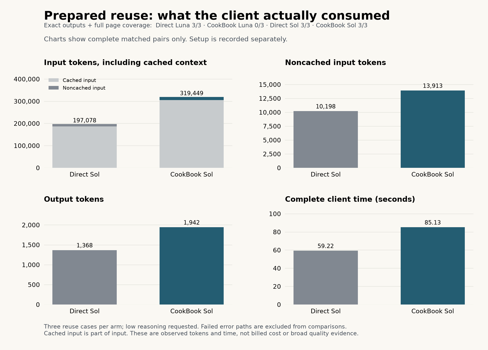

# E02 — prepared token efficiency on the normal project connection

**The first matched study did not demonstrate token savings.** Nine of twelve
held-out outputs passed. CookBook Luna could not connect after its agent added a
newline to the project proof. CookBook Sol completed all cases but consumed more
client tokens than the equivalent prepared direct script. Both findings are
retained; subsequent repairs and their regression checks are separate evidence.

## What was compared

The synthetic task reads every page of settlement records, validates and deduplicates
rows, filters eligible records, aggregates by account and currency, and returns a
complete JSON result with source evidence. Both arms use the same prepared local
pipeline. Direct agents may retain and call their script; CookBook agents call a
registered recipe through the normal six-tool project-aware MCP connection.
Neither arm must page through raw records inside the conversation.

Four ephemeral Codex conversations each contain one untimed setup/development turn
and three reuse turns, counterbalanced across arms. Models were `gpt-5.6-luna` and
`gpt-5.6-sol`, with low reasoning requested on every turn. The owner-approved
persistent `apr_run` trust policy was active. No tools were hidden to make CookBook
look smaller. The APR user skill appeared in every arm's available-skill catalog.

The [frozen protocol](fixtures/e02-token-efficiency/protocol.json),
[task contract](fixtures/e02-token-efficiency/contract.md),
[synthetic pages](fixtures/e02-token-efficiency/source-pages.json) and
[expected outputs](fixtures/e02-token-efficiency/expected-outputs.json) preserve
the workload. An independently written SQL/row audit agreed with all four oracle
outputs. This is deterministic engineering evidence, not human-reviewed E05 truth.

## Observed results

| Arm | Exact output and complete pages | Reuse wall time | Total client tokens | Noncached input | Output |
| --- | --- | ---: | ---: | ---: | ---: |
| Direct Luna | 3/3 | 37.220 s | 198,340 | 13,180 | 1,352 |
| CookBook Luna compact | **0/3; setup failed** | 31.768 s, errors | 170,269, errors | 10,173 | 608 |
| Direct Sol | 3/3 | 59.218 s | 198,446 | 10,198 | 1,368 |
| CookBook Sol compact | 3/3 | 85.130 s | 321,391 | 13,913 | 1,942 |

Failed error paths are not savings. In the only valid matched pair, CookBook Sol
used **36.4% more noncached input**, 62.0% more total client tokens and 43.8% more
wall time than direct Sol. All 18 expected pages were accessed exactly once by
each successful arm. Every scored turn had zero approval-review events.

The [case CSV](fixtures/e02-token-efficiency/case-metrics.csv) retains all sixteen
amended setup/reuse turns. [Aggregate metrics](fixtures/e02-token-efficiency/metrics.json)
include the earlier aborted infrastructure setup. Cached input is a subset of
input, not an additional charge. Total tokens equal input plus output; reasoning
output is a subset of output. Effective reasoning effort, service tier, internal
model-call count, review-model usage and billed dollars were not emitted and stay
unknown. Exact raw-event token deltas and source coverage were independently
recomputed in the [verification export](fixtures/e02-token-efficiency/verification.json).

## Why execution outside the conversation was insufficient

The complete CookBook Sol outputs arrived from `apr_run` in **182–220 ms** each.
The recipe was fast. Each reuse turn also reloaded the authoring `SKILL.md` before
running, adding an unnecessary tool exchange and context. Durable worker spans
totaled 0.617 s; captured CookBook tool intervals totaled 0.804 s versus 0.095 s
direct. Most wall time remained outside those intervals. The traces identify
avoidable skill loading but do not isolate every component of client latency.

Three perspectives matter:

- **Client context:** each extra tool exchange can cause the model to process the
  retained conversation again. Compact results help, but avoiding unnecessary
  exchanges matters more than trimming a few receipt fields. Cache hits must be
  reported separately from new input and never converted to invented dollars.
- **Workflow design:** keeping pagination, transforms and intermediate artifacts
  inside a recipe protects the caller's context. A competent reusable script does
  that too. The case for CookBook is reusable orchestration, approved connections,
  durable recovery and selective model calls, not a guaranteed token advantage
  over an equally prepared script.
- **Quality and model choice:** deterministic work needs no model reasoning inside
  the recipe. Semantic decisions can use a named external model or Jev at the
  appropriate node, but substitutions need held-out quality evidence. This study
  did not evaluate live provider quality, cost routing or Jev economics.

## Changes implemented in response

The implementation plan was to remove repeat approvals after owner consent, make
routine execution use the known contract directly, reduce success-only metadata,
and validate complete results against a fair prepared baseline. It produced:

1. The approved persistent Codex run policy, retaining CookBook's workspace,
   connection, interpreter, source-pin and revocation checks. Other tool permissions
   remain unchanged. The [earlier trust diagnostic](2026-09-22-e02-trusted-prepared.md)
   remains a separate, non-interleaved observation.
2. An opt-in compact receipt that removes step-progress metadata only after full,
   untruncated success. The complete business output and receipt identity remain;
   full audit inspection is still available. A sixteen-step regression reduced
   serialized receipt size from 1,719 to 495 bytes, **71.2% fewer bytes**, not a
   measured client-token reduction. Errors and caller handoffs are unchanged.
3. A shorter authoring skill with complete guides loaded on demand. After this
   study exposed repeated reads, its trigger was narrowed to setup, authoring and
   troubleshooting; MCP initialization explicitly covers unchanged prepared runs.
4. Strict semantic project-proof comparison: exact challenge, nonce and root
   strings, with JSON whitespace/key order allowed. Duplicate, missing, extra,
   altered and oversized payloads are rejected. Pinned-directory, ownership,
   link, mode, freshness and revocation checks remain. A public MCP regression
   reproduced the extra-newline failure before the repair.
5. Required nonempty workspace fields in the normal project-aware run, inspect,
   resume and manage schemas. Public guide discovery and fixed attachments remain
   compatible. A failed connection cannot be repaired by omitting authorization.

The later native package and bounded post-repair client regression are recorded
in the [runtime validation log](../logs/runtime-validation.md). They do not replace
this failed benchmark. A new comparative savings claim requires a separately
frozen matched study after the repaired client path is reliable.

## Separate post-repair client regression

The installed repaired candidate was then checked in **four new model turns**:
Luna-low and Sol-low each connected, ran the development case, and reused the
prepared recipe once. All four full outputs and source-page traces matched.
Both reuse turns used exactly **one `apr_run`**, with **zero skill reloads,
inspections or approval reviews**. Recipe execution took 198 and 206 ms.

| Prepared reuse after repair | Exact full result/pages | Client wall | Total tokens | Cached input | Noncached input | Output |
| --- | --- | ---: | ---: | ---: | ---: | ---: |
| Luna-low | pass; 6/6 pages | 14.252 s | 70,683 | 61,952 | 8,188 | 543 |
| Sol-low | pass; 6/6 pages | 22.934 s | 66,797 | 58,240 | 7,942 | 615 |

Setup remains separate: Luna took 53.173 s and 279,389 tokens; Sol took 53.363 s
and 194,478 tokens. Each setup successfully read the skill once. Luna also
attempted an invalid stale skill path and requested a project proof twice before
connecting; both sources of extra setup work are retained. No recipe
execution was retried and no harness approval request was answered.

This is a client regression using the **same previously exposed cases**, without
new direct arms. It verifies removal of the observed extra tool exchange, not a
causal token saving or a fresh quality/generalization benchmark. The CSV retains
the harness phase name `holdout` for reuse; these cases are no longer unseen.
[All four rows](fixtures/e02-token-efficiency/post-repair-case-metrics.csv),
[sanitized tool events](fixtures/e02-token-efficiency/post-repair-tool-events.jsonl),
[per-turn checks and provenance](fixtures/e02-token-efficiency/post-repair-metrics.json)
and the [separate protocol](fixtures/e02-token-efficiency/post-repair-protocol.json)
retain that distinction. Raw final messages, cumulative token deltas and source
coverage were independently rechecked. The candidate APR SHA-256 is
`df9b08eae1d36d10b2dded2047d63e9cb1e2239845417e535ab05842b36b37b8`;
installed skill SHA-256 is
`ec7a9297d92b86300f4557c37b0cb7c43b2ebec3041e80a3e9b81714129e01c2`.

The four regression turns are additional to the preserved seventeen-turn study.
All disposable services/app servers stopped. The lead removed only the three
exact test-project trust rows Codex created across the study and regression,
verified preservation of every other parsed setting, and retained the approved
`apr_run` policy. Live accounts, grants, requests and histories remained intact.

## Setup, failures and evidence boundaries

Amended setup costs were direct Luna 20.801 s/68,724 tokens; direct Sol
44.317 s/93,742 tokens; CookBook Sol 88.072 s/194,293 tokens; and failed CookBook
Luna 60.882 s/225,983 tokens. These costs were excluded from reuse timing and remain
visible. CookBook Sol setup had two automatic file-change reviews totaling
12.808 s; failed Luna setup had one totaling 10.995 s. None was an `apr_run` review.

One infrastructure attempt stopped after a correct direct-Luna setup because
Codex automatically added a disposable project trust row. It used 27.290 s and
85,808 tokens, with zero holdouts exposed. A single recorded amendment permitted
only the exact disposable trust rows and froze every other parsed setting. The
amended study ran once: **17 model turns across both attempts**, no replacement
of failed model cases. The harness answered no approval requests.

Before model use, the prepared worker and recipe were checked against the same
oracle and an injected third-page failure. The direct path failed without success
output; the runtime conservatively retained its attempt as needing reconciliation.
No uncertain dispatch was retried. The successful model-free source-access log
was overwritten before the failure check, so that preliminary check does not
claim retained success-page coverage. The scored model turns each have their own
preserved page log and independently verified coverage.

The measured candidate APR SHA-256 was
`9d4def67c90fd71584ed7233d58bb30169005d21cfcc039a39eb1628eead63c5`;
its skill SHA-256 was
`f4e5b8275f8c881dd6c32f9a6467bbd4817abd566cc3ccaac557567d55a24dee`.
[Provenance hashes](fixtures/e02-token-efficiency/provenance.json) identify the
private freeze, raw report and exported data. Raw client events, timings, prompts
and disposable runtime evidence remain in ignored local
`work/evals-2026-09-22/token-efficiency-projects-amended/`; the aborted attempt is
preserved beside it. Public exports contain synthetic data, not credentials or
live project content. This local small sample excludes real network latency,
rate limits and long production conversations. E03 uncertainty and E05's human
review block remain unchanged; no launch acceptance or general savings claim follows.
