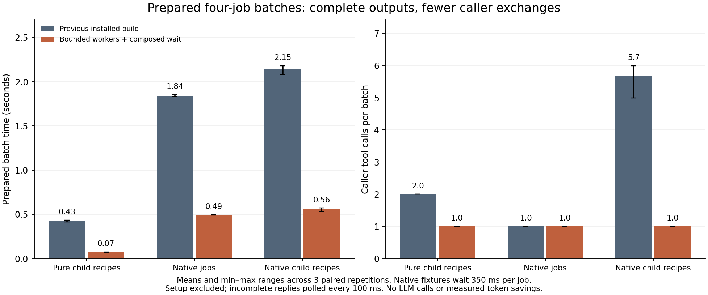

# Prepared composed batches and bounded workers

Recorded 2026-09-22 on macOS 26.6.2 ARM64. This is a model-free comparison of the
previous installed executable and a fresh development-signed 0.2.0 package.
It measures prepared MCP calls, complete outputs and actual native overlap.
It is not a Codex/Luna comparison or evidence of model-token savings.

## Result

All **18/18 batches and 72/72 item outputs** passed exact checks. All nine
new-build batches returned their complete output in the original call. Every
native batch reached four overlapping workers on the new build, versus one on
the previous build. Request-key replay preserved run IDs and outputs without
adding effects in every arm.

| Four-job batch | Previous mean, seconds | New mean, seconds | Previous calls per batch | New calls per batch |
| --- | ---: | ---: | --- | ---: |
| Pure child recipes | 0.426 | 0.069 | 2, 2, 2 | 1 |
| Direct native jobs | 1.839 | 0.493 | 1, 1, 1 | 1 |
| Native child recipes | 2.147 | 0.557 | 6, 5, 6 | 1 |

The two native cases were 3.73 and 3.86 times faster by their mean batch times.
Across all nine measured batches per build, caller calls fell from **26 to 9**;
compact JSON response bytes fell from **43,916 to 9,894**. These totals depend on
the fixed 100 ms inspection policy and the existing compact-success reply versus
full inspection contract. They are not token counts. Direct native replies have
identical byte counts before and after; their gain is execution time.

Chart error bars are observed minimum–maximum ranges, not confidence intervals.
The [SVG](fixtures/parallel-batches/batch-workers.svg),
[metrics JSON](fixtures/parallel-batches/metrics.json),
[CSV](fixtures/parallel-batches/metrics.csv) and
[chart provenance](fixtures/parallel-batches/chart-provenance.json) are retained.

## Frozen procedure and quality

The [protocol](fixtures/parallel-batches/protocol.json) and its
[SHA-256](fixtures/parallel-batches/protocol.sha256) were written before execution.
The committed [measurement helper](../../tools/evals/measure_batch_workers.py)
records both executable hashes, its own source hash and the native worker hash.
Three pairs ran in alternating old/new, new/old, old/new order; each arm ran the
same three cases once. No failed case was replaced and the packaged comparison
completed on its first attempt.

Each arm started with a new private project, attachment and runtime. Recipe
registration, the pinned Python grant, service startup, MCP initialization and
discovery happened before the reuse clock. Their observed combined setup times
are retained in [setup metrics](fixtures/parallel-batches/setup-metrics.json);
human installation and authoring time were not measured. A 5,000 ms bounded wait
was requested in both builds. An incomplete response was inspected every 100 ms.
The clock ended when the complete output was available; replay checks happened
afterward, outside that clock.

Each native job waits 350 ms and returns its complete input plus monotonic
start/end timestamps. The four inputs exercise nested JSON, Unicode, whitespace,
newlines, booleans, null and numbers. Assertions require exact payloads, all
expected fields, no additional fields and stable keyed input order. Timestamps
are observed measurements, not expected equal values. Interval overlap measures
concurrency; it is not inferred from declared capacity. This is an I/O-wait
fixture, not a CPU-throughput or live-provider benchmark.

Each of the six private stores ended with 11 successful runs, eight native effect
intents, zero billing calls and zero saved accounts. Database integrity and
foreign-key checks passed. Raw MCP requests/replies, setup contracts, timestamps,
manifests, stores and stderr remain in ignored private
`work/composed-batch-validation/prepared-comparison/`. Public exports contain
synthetic data and selected metadata only. All fixture services/transports stopped.

## Implementation and safety evidence

Short bounded MCP waits now follow complete runnable child trees, while returning
for actionable handoffs, held/uncertain work or exhausted limits. The service
prepares up to four independent native/API operations; worker threads do no
database writes. One coordinator retains the writer lock, durably reserves
budgets before launch, and settles every observation in deterministic order.
Lower foreach limits, frozen sources/grants, dependency order and same-credential
OAuth serialization remain enforced.

Required workspace checks passed: formatting, strict all-feature Clippy,
**398 default tests** and **440 fault-injection tests**, with one pre-existing
ignored test in each suite. Full-schema documentation validation and native
strict Clippy passed. Focused coverage includes:

- Actual native and controlled HTTP overlap, the cap of four, lower limits,
  child composition, output order and request-key replay.
- Shared provider/money reservations, revoked grants, source pins and serialized
  OAuth refresh for the same credential reference.
- Multi-worker native cancellation across children, later admission fences,
  rejected cancellation cleanup and shutdown.
- Crash after durable reservation, uncertain effects without replay, mixed
  sibling outcomes and settlement failure without stranding unrelated work.
- One-call child completion and prompt return for genuine caller handoffs.

Independent reviews found cancellation/settlement races during implementation;
the fixes and focused regressions passed subsequent review. Earlier local
fixture/lint/build-environment failures remain in ignored validation logs. The
controlled HTTP fixture needed blocking accepted sockets on macOS; a test token
fixture needed the normal encoded envelope. Packaging used the existing virtual
environment after system Python lacked `jsonschema`; rebuildable Cargo cache was
cleared after a link attempt exhausted disk space. No runtime assertion, approval
or security control was removed to obtain the passing final result.

## Package and native installation

The package was built from clean source
`fb29e763cf77721784bf34b693bf4dca7ff7fa08`, source snapshot SHA-256
`23c6fbecbc20c2907910072446d3c301c0860f865effce0b95819e550647d8ab`.
This report and its exports were added afterward; they do not change the tested
runtime. The exact mounted package supplied the candidate benchmark executable.

| Artifact | SHA-256 |
| --- | --- |
| Previous APR executable | `df9b08eae1d36d10b2dded2047d63e9cb1e2239845417e535ab05842b36b37b8` |
| New APR executable | `63d382cc74ea6a952bd8e8e1aa4ec98009befeffa161420d111e7fa0c09aac47` |
| New native desktop executable | `32eae1df58ce4afbdfc7eec26b2d9ed696a953c6c1d91f0d04198454f3f672ff` |
| `CookBook APR_0.2.0_aarch64.dmg` (18,562,625 bytes) | `004b005d940a629a64b4baf9a254b5707e80a346adbc66cb2bea104dbda37dc3` |

The development-signed Jev-enabled package passed strict deep signature and DMG
checksum checks. It is not notarized or production signed. The real Tauri app
ran from the read-only mounted DMG against disposable state: Home connected,
Runs displayed successful batches, and the composed run showed all four
successful child runs and the pinned child version. Process paths verified both
the mounted UI and mounted sidecar; no live provider was called.

The mounted bytes replaced the local app with the prior app retained for rollback.
The installed UI reconnected to its service. Before/after hashes matched across
all existing database tables, the credential file and saved desktop selection;
six accounts, ten grants, twenty requests and twenty-four runs were preserved.
The two pre-existing uncertain runs were not retried. Credentials retained mode
0600; integrity and foreign keys passed. Installed executable hashes matched
the tested package, and the disposable volume was unmounted.

Old already-running MCP bridges retain their loaded implementation. Reconnect
CookBook in the client or open a fresh client session to load the new bridge;
do not assume an existing conversation has refreshed merely because the desktop
app was updated. A fresh candidate bridge advertised `parallel_execution: true`
and `max_parallel_workers: 4` in every measured arm.

## Limits and next measurement

This replaces the serial-dispatch limitation recorded in the earlier
[batch capability check](2026-09-22-batch-execution.md), not its historical results.
Pure/control transitions and optional model-sampling workers remain serial.
A dispatch wave waits for its slowest member; ordinary owner writes queue behind
that wave, while inspection and authenticated native cancellation remain
responsive. Longer work, larger trees and human/agent handoffs still return a
durable run for later inspection. HTTP calls cannot be unsent.

The sample is small, synthetic and local. No LLM tokens, paid API results,
production quality, cross-platform performance or full-client speedup were
measured. A fresh matched client study should let both arms batch and reuse their
prepared work, freeze complete quality expectations, and retain setup, cached
input, noncached input, output/reasoning, tool calls and failures separately.
Parallel execution and fewer replies make that study worthwhile; they do not
establish its outcome in advance.
