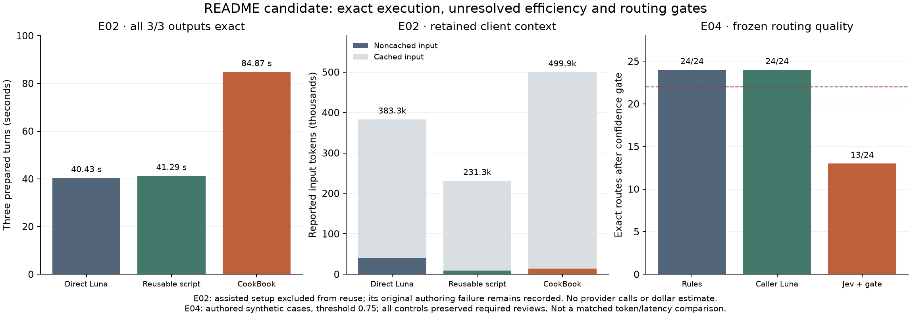

# README evaluation of the configurable-worker candidate

Recorded 2026-09-22 against the installed 0.2.0 development app, APR SHA-256
`779e75c0b17038e0f9d4a317068a5d3127d15ebecff3cc69574cacd0af273781`.
The [capacity report](2026-09-22-worker-capacity.md) identifies the exact source,
DMG, native validation and preserved installation. This report covers actual
client/provider behavior. **The broad launch gate remains unpassed.**

The subsequent [value diagnosis](2026-09-22-value-diagnosis.md) audits these
traces, corrects the E02 tool/skill-loading description, distinguishes E04's
simulated gate from real orchestration, and adds a matched Sol cost comparison
plus an actual native Computer Use attempt.

## E01 — first use and project boundaries

Codex created its own CookBook project, registered the installed save-note
starter and verified two exact saved artifacts. A separately rooted second
project then saved its exact note, authored a caller-choice recipe, paused for
the caller, resumed the same request with choice A, and returned exactly
`{"choice":"A"}`. Inspecting the first project's run with the second workspace
returned an actual `FORBIDDEN` response. There were zero external effect intents.

One harness attempt incorrectly reused the first project's Codex working
directory for the second project. The normal client sandbox refused file writes
there. That attempt remains recorded; the correction started one new session
rooted in the second project, without weakening the sandbox. All three artifacts,
the actual handoff and the refusal were checked against retained state/events.

The [session metrics](fixtures/readme-candidate/e01.json) retain the successful
turns and the failed harness turn. The client was Codex
`0.155.0-alpha.9.2`, using `gpt-5.6-luna` with low effort requested; effective
per-turn effort was not independently reported. Claude Code was not installed
and remains untested. This passes the bounded notes/handoff/scope journey, not
all first-use setup: E02 exposed an unresolved authoring problem below.

## E02 — setup failure and prepared execution

The task takes only a record ID, reads two approved synthetic local sources,
normalizes customer/currency, computes invoice totals and keeps both exact source
references. It uses no artificial waits or provider calls. The planned slice is
three holdouts across direct Luna, a reusable script and CookBook, with setup
outside reuse timing and counterbalanced order.

Original development setup succeeded in the direct and script arms. The
CookBook authoring turn stopped at its 180-second limit after repeated generic
`INVALID_MANIFEST` replies; no holdout was dispatched. Its script omitted the
Python capability language and declared a read effect. Trusted native scripts
require a write effect even when the intended operation reads sources. The
published structural schema permits the read value; the semantic validator's
reason was not exposed in the reply. The agent guessed at fields instead of
recovering. This remains a failed autonomous first-use result.

A separate assisted-setup amendment prepared a valid source-pinned worker using
only the development ID. The lead's first preparation also hit the semantic
write-effect requirement and was rejected before registration or execution;
that failed preparation is retained. No security check was relaxed. Original
setup tokens and time remain in the record, and assisted preparation is not
credited as autonomous authoring. Three new client sessions practice the saved
contracts before the same previously unqueried holdouts. Complete exact output,
both source reads, the model and counterbalanced order stay fixed.

The assisted prepared comparison passed **9/9 exact outputs** and both source
reads in every case. Every CookBook result came from a new successful run of the
registered recipe; model-written output alone was not sufficient. A separate
service-restart/request-key replay returned the same run and full output, with
no additional effects or source reads.

| Prepared arm (Luna, low requested) | Exact outputs | Three turns, seconds | Execution and file-edit items |
| --- | ---: | ---: | ---: |
| Direct source commands / allowed helper | 3/3 | 40.426 | 9 |
| Reusable script | 3/3 | 41.293 | 9 |
| CookBook saved recipe | 3/3 | 84.867 | 12 |

CookBook took 2.10 times the direct arm's wall time and 2.06 times the script
arm's. Its three APR calls returned complete results in 167, 194 and 203 ms,
without additional APR inspection or client approval reviews.
**Trace-audit correction:** the agent read the APR skill and searched memory in
all three prepared CookBook turns. The original claim of no skill loading was
incorrect. The original harness tool counter also omitted file-edit items: its
retained JSON reports 6/6/9 command/MCP calls, whereas the table now includes the
three file edits in each arm. Raw traces and original counters remain unchanged.
Client orchestration and writing the required output files remain in the
end-to-end clock. The local runtime does not explain most of this measured gap.

| Prepared arm | Input tokens | Cached input | Noncached input | Output tokens (reasoning subset) |
| --- | ---: | ---: | ---: | ---: |
| Direct | 383,334 | 343,040 | 40,294 | 1,524 (187) |
| Script | 231,305 | 221,952 | 9,353 | 1,469 (88) |
| CookBook | 499,945 | 485,632 | 14,313 | 2,269 (213) |

CookBook used 64.5% fewer noncached input tokens than the direct arm, but 53.0%
more than the reusable script. Its total input and output were higher than both.
These cache-sensitive observations on three small sequential tasks do not
establish total token or monetary savings. No stronger-model comparison or
parallel client workload was measured here. Unknown subscription prices and
manual setup time prevent a dollar break-even calculation.

The [case JSON](fixtures/readme-candidate/e02-cases.json),
[CSV](fixtures/readme-candidate/e02-cases.csv),
[setup ledger](fixtures/readme-candidate/e02-setup.json),
[aggregate/tool timings](fixtures/readme-candidate/e02-aggregate.json),
[replay proof](fixtures/readme-candidate/e02-replay.json),
[protocol](fixtures/readme-candidate/e02-protocol.json),
[task](fixtures/readme-candidate/e02-source/TASK.md),
[synthetic inputs](fixtures/readme-candidate/e02-source/sources.json) and
[expected outputs](fixtures/readme-candidate/e02-source/oracle.json) remain available.
The actual client used a fixed assignment attachment, so this does not silently
qualify the normal project-discovery path. Oracle files were outside the client
project roots; same-user filesystem access and agent-authored synthetic cases
are not independent blinded custody.

## E03 — chosen external model

The frozen study planned ten extraction cases, two providers and two repetitions,
with a ceiling of 40 dispatches including failures. The exact-output rubric
requires every value and its source line, preserving missing fields as null.
The selected models were `openai/gpt-4.1-mini` through OpenRouter and
`gemini-2.5-flash-lite` through Gemini. The
[synthetic protocol](fixtures/readme-candidate/provider-protocol.json) retains
the inputs, model-specific boundary and acceptance floor.

The first fresh OpenRouter attempt became uncertain after 45.073 seconds,
matching the recipe's step timeout. No output or usage was committed; the other
19 cells were not dispatched. Its adapter receipt directory was absent. Local
no-credential initialization/tool-list probes could succeed, but other bounded
dummy probes stalled before a response. These observations do not identify the
live failure stage or prove that a provider request was absent. The uncertain
attempt was neither retried nor reconciled.

The saved Gemini binding referenced an older source lock. The owner explicitly
approved a reviewed update for the synthetic assignment using the existing saved
account, with no key re-entry or all-project sharing. A protected, non-generation
model-metadata probe then timed out after 30.026 seconds and became uncertain.
No provider receipt or underlying connector exception was retained. Generation
was stopped: all 20 Gemini extraction cells remain undispatched. One earlier
metadata manifest was rejected for missing configuration before any run; that
admission failure and its correction are retained separately.

No paired provider-quality, cost or latency conclusion is available.

## E04 — Jev routing and learning from Other

All 24 classification calls completed through reported model `jev-1.13.0`. The frozen
confidence threshold remained **0.75**, with a quality floor of **22/24 exact
routes and every mandatory review preserved**.

**Trace-audit clarification:** the frozen recipe contains one Jev observation
step. The evaluation script applies the confidence gate and computes the route;
it does not execute APR decision, child-process or caller-review nodes. This is
a component classification/policy test, not an end-to-end orchestration test.

| Control | Exact routes | Missed required reviews | Unnecessary reviews |
| --- | ---: | ---: | ---: |
| Rules from the synthetic specification | 24/24 | 0 | 0 |
| Caller Luna, one batch | 24/24 | 0 | 0 |
| Jev, after the frozen confidence gate | 13/24 | 0 | 5 |

Jev's raw choices matched 21/24; the configured confidence gate reduced accepted
routes to 13/24. All six Other cases ultimately routed to review as `unclear`,
and five supported cases received unnecessary review. **The quality gate failed.**
Reducing the threshold after seeing these cases would not pass this frozen study.
The rules were written against the same specification and synthetic style;
their perfect score is not evidence of broad natural-language generalization.

Jev reported 10,128 input and 1,113 output tokens. Its median single-call elapsed
time was 0.512 seconds, range 0.429–0.667. Caller Luna returned all 24 choices in
one 6.741-second turn, reporting 21,074 input tokens (9,984 cached) and 211 output
tokens, including 78 reasoning tokens. Low effort was requested; the effective
per-turn effort is unobserved. These differently batched invocation shapes do
not form a matched token, latency or cost comparison. A broken PATH wrapper
failed before its model initialized; the successful native client matched the
E01/E02 executable hash, and both attempts were retained.

The separate eight-example discovery run completed five provider effects, then
the sixth became uncertain after 0.598 seconds. The final two examples were not
dispatched. No completed learning output, candidate, held-out evaluation or
adoption resulted. Partial step observations were not promoted to qualifying
learning evidence. The connector exception and charge were not retained, so the
precise cause remains unresolved. There was no retry or production change.

[Per-case Jev predictions and confidence](fixtures/readme-candidate/jev-cases.json)
and [provider aggregates](fixtures/readme-candidate/providers.json) preserve the
failed quality gate, undispatched cases, reported usage and unknown charges.
This does not establish a Jev benefit or disprove its usefulness for other
task-specific categories. This particular policy did not qualify.

The safety and automation denominators also matter: all 12 required reviews
were preserved, while only 7 of 12 supported tasks avoided review. Those seven
automatic choices were correct in this sample. The 13/24 exact-category result
also penalizes `other` becoming `unclear`, even though both require review.
These additional diagnostics do not change the failed frozen quality gate or
establish safe generalization beyond these 24 synthetic cases.

## E05 — reviewed improvement controls

The candidate reran the exact previously owner-reviewed six-development,
six-held-out fixtures as a regression check. The labels were already exposed
to agents; this is not fresh blinded generalization evidence.

| Candidate/control | Executed holdouts | Exact outputs | Expected and observed result |
| --- | ---: | ---: | --- |
| Simpler correct recipe | 6 | 6/6 | Pass |
| Cheaper but wrong | 6 | 0/6 | Fail |
| Missing evidence | 6 | 0/6 | Fail |
| Unsupported provider | 0 | Not measured | Inconclusive |
| Effectful candidate | 0 | Not measured | Inconclusive |

All five saved reports matched their owner CLI readbacks, with one evaluation
per cycle. Explicit fixture-only adoption and rollback preserved prior run and
schedule pins; the schedule stayed paused. There were zero saved accounts,
grants, effect intents and billing calls in this disposable store. Integrity
and foreign-key checks passed. [Selected metrics](fixtures/readme-candidate/e05.json)
retain the review receipt hash and report digests.

The archived helper sent an unsupported `detail` field during final CLI readback
after evaluation and rollback had finished. Read-only retrieval of those same
reports completed verification; nothing was reevaluated. Fewer pure steps are
not measured dollar or token savings.

## Evidence limits and next fixes

The worker feature has native/package and local concurrency evidence. Launch
acceptance still needs recoverable recipe-authoring feedback and a resolved,
reliable external-adapter path. Jev's current routing policy fails its frozen
quality floor; learning stopped before candidate evaluation. Claude Code and
other platforms remain outside the tested claim.

All provider billing amounts remain unknown where no invoice/readback exists.
Fresh study ceilings were $0.50 each for OpenRouter/Gemini and $0.25 for Jev;
historical uncertain-call ceilings were reserved separately. Their combined
$3.50 planning reservation is not observed spending or an assertion that failed
calls were free. No uncertain attempt was retried, no credential was exported,
and no production recipe or classifier was adopted. Raw traces, approval data,
runtime stores and private filesystem paths remain outside Git.
