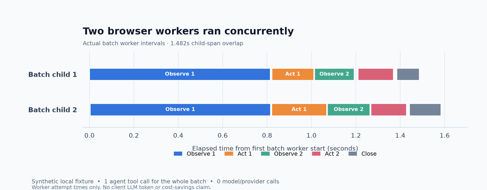

# Preserve a solved workflow: background browser qualification

The agent first completed a synthetic two-step browser task and retained the
observed actions and final result. A CookBook recipe derived from that reference
then reproduced all **four complete outputs**, including two concurrent jobs,
without internal model calls or use of the foreground desktop. This qualifies a
bounded local execution path; it is not a client-token or cost comparison.

## Reference and preparation

The reference opened the local audit page, clicked **Begin audit**, observed
**Audit reviewed**, clicked **Approve release**, and observed **Release approved**.
The actual actions, intermediate conditions, final path/text and a screenshot
were saved before creating the recipe. The recorded plan was extracted from
those observations. No successful workflow was inferred from a proposed script.

The scaffold freezes the reviewed origins, helper source, browser executable,
actions and expected conditions. Each action has its own durable effect intent,
fresh observation and postcondition. Missing or ambiguous controls and failed
conditions stop for review. The successful recorded path needs no Jev or caller
decision; caller/Jev modes remain available for unresolved choices.

Preparation included a private Python environment, Playwright 1.63.0 and its
headless Chromium, a disposable project/assignment and an owner Python grant.
Installation, reference solving, authoring and preflight are excluded from the
reuse times below. The service was already running; each leaf run created a fresh
browser session. This tests one exact synthetic workflow, not generalization to
unseen business cases or an autonomous conversation-to-recipe compiler.

## Packaged execution

Measured from the MCP start request to its completed response, using the mounted
development package and disposable state:

| Prepared execution | Complete expected outputs | Wall time | Agent tool calls |
| --- | ---: | ---: | ---: |
| First reuse | 1/1 | 2.046 s | 1 |
| Next reuse | 1/1 | 1.520 s | 1 |
| Two independent jobs in one batch | 2/2 | 1.677 s | 1 |

All outputs retained the exact completion evidence, two completed actions and a
successful browser close. Each batch child had its own private session. A repeated
start with the same request key returned the original result and added **zero**
HTTP requests. Read-only SQLite audit found five succeeded runs (two solo, one
batch parent and two children), twenty succeeded Python effect intents, zero
handoffs and zero connector/provider calls. Model decision requests were zero.

The child worker spans overlapped by **1.482 seconds**. These are recorded worker
attempt intervals, not model timing. [Sanitized metrics](fixtures/reference-first-browser/metrics.json)
and the [vector chart](fixtures/reference-first-browser/batch-worker-timeline.svg)
preserve the values. Four outputs and two batch children are a qualification
fixture, not a throughput distribution or evidence for 64 browser sessions.

An earlier debug-build rehearsal also passed all four outputs. Under concurrent
verification load it took 5.522 s, 4.991 s and 4.974 s; its first run needed later
inspection. It remains recorded separately and is not an A/B speed comparison.

## Failure probes and corrections

All seven final real-browser probes passed: reference replay, redirected
destinations, an unlisted form POST destination, foreign run/goal/handle rejection,
changed target refusal, cookie isolation and lease cleanup.

The first redirect probes exposed an actual defect: checking an initial redirect
destination did not prevent Chromium following a later redirect outside the
allowlist. The failed traces are retained. The repaired helper rejects **all HTTP
redirects and Refresh responses before browser delivery**. Final probes observed
zero requests at the forbidden destination, including POST. This deliberately
limits compatibility; redirect-dependent sites are currently unsupported.

The browser uses a fresh context and no user profile or debugging port. Private
session sockets are run/policy/goal-bound, observations are single-use, and an
external lease supervisor cleans up abandoned browser processes. The host supplies
`APR_RUN_ID` through the cleared worker environment; legacy worker JSON envelopes
remain unchanged. The helper is trusted native code, not an OS network sandbox.

Native macOS actions now have an exclusive operation lock and fixed, redacted
failure categories. The prior native action failure remains unresolved: these
browser results do not prove that foreground action now succeeds. No live native
desktop action or paid provider call was dispatched in this qualification.

## Authoring, diagnostics and Jev regression coverage

The short installed skill and version-matched MCP authoring guide now teach
**solve, verify, preserve, derive, validate, reuse**. The guide includes a portable
redacted reference template. Missing evidence remains unknown; CookBook does not
automatically capture or compile agent conversations.

Admission errors now carry bounded, allowlisted repair information through the
actual service-to-MCP boundary. Worker and connector failures retain safe categories
without leaking stderr or payloads or enabling retries of uncertain effects.
Regression tests reopen uncertain native work and confirm no duplicate execution.

The Jev example now executes the complete observation, policy, branch and artifact
graph. Four controlled-provider cases cover accepted routing, review, invalid
input and invalid provider output. These are integration tests, not live Jev
quality or confidence calibration. The older failed E04 gate remains failed.

## Required checks and native installation

All seventeen local verification steps passed: formatting; strict all-target,
all-feature workspace Clippy; **417 default**, **460 fault-injection** and **466
all-feature** Rust tests (one existing ignored test in each suite); full-schema
documentation; distribution tests; **46 UI tests**; and JavaScript syntax checks.
Native desktop Clippy and all six development packaging/signing steps also passed.
The Rust suites include the 36 native-worker and four offline browser-worker Python
fixtures; those fixture counts are not additional Rust tests.

Verification and packaging used the same source snapshot:
`4e1f54b1b2c52324afb85c1db0ed8e823a484ae74455261d2deac0fe5ffb1c31`
at parent commit `a3f795db25b41d0a77779ac509e0f8f36713c6c5`, including uncommitted
implementation files. Source hashes were unchanged during both runs. Later report,
index and product/measurement-document edits are not part of that binary snapshot.

The mounted DMG passed strict deep signature verification. Its real Tauri UI
rendered against disposable state and showed idle execution settings. The same
bytes were then installed, reopened and observed as **Local service connected**.
All fifty live table row counts/hashes and the private credential file hash were
unchanged, including six saved accounts, thirteen execution grants, twenty-one
connection requests and five runs needing reconciliation. None was replayed or
reconciled. The prior app is retained locally for rollback.

The managed Codex refresh changed only its owned skill; the Codex configuration
remained byte-identical, including the previously approved run trust. New MCP
processes load the new embedded guides. Existing attached processes were left
running and need reconnection to load the updated binary.

Package: `dist/cookbook-0.2.0-reference-first-browser-development-signed/packages/dmg/CookBook APR_0.2.0_aarch64.dmg`
(18,720,643 bytes), macOS ARM64 0.2.0, optional Jev included, Apple Development
signed; no production signing or notarization.

| Artifact | SHA-256 |
| --- | --- |
| DMG | `d930d639b0801777fed3b52561e53d4f26782b99b4b4936a90844eba8362d614` |
| APR sidecar | `b36305f13c645490c78cabe2d7868c60c3f747ed4bd494a7a6bc45a3393c2234` |
| Desktop executable | `112b57be9958736a3c9149df1d81d25a22b03abcb876a969576831965330e647` |

Private raw observations, original failed probes, MCP traces, SQLite state,
native UI evidence, install records and verification logs remain under ignored
`work/browser-reference-20260922/` and `work/reference-first-verification-final-20260922/`.
Only sanitized aggregate evidence is committed.

## Remaining qualification

The browser helper does not support persistent logins, text/password entry,
uploads, downloads or HTTP redirects. Playwright and Chromium require one-time
preparation and reviewed native access. General native-app compatibility and the
earlier uncertain external-provider calls remain unresolved. A stronger Jev
recipe still needs task-specific labeled calibration and live qualification.

The next economic comparison should start from an already solved useful workflow,
freeze the reference and derive both a competent script and CookBook recipe from
it. Use fresh matched inputs, the same model/effort and complete quality checks;
measure every recurring model turn and internal provider call. Existing evidence
does not establish a token or dollar saving. See the
[cost/quality diagnosis](2026-09-22-value-diagnosis.md) and
[browser setup](../runbooks/background-browser.md).
