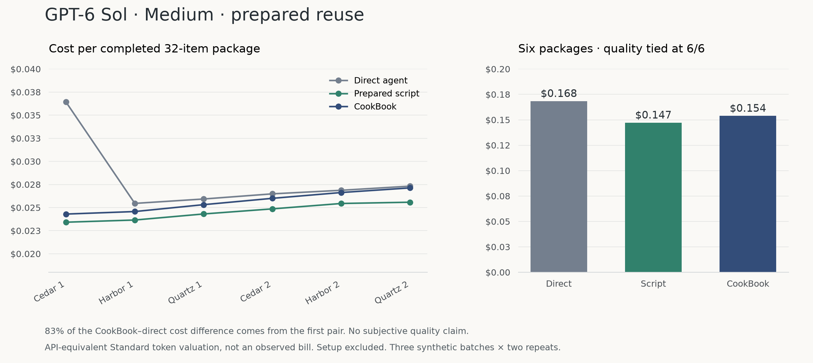

# Why the current evaluations have not demonstrated CookBook's value

The current results do not establish a speed, cost or quality advantage. They
also do not test several central product claims. There are real product defects,
avoidable client overhead, and evaluation-design mistakes. Changing the headline
or counting only successful cases would not fix any of them.

This audit independently reconstructed the retained E02 client events and E04
case rows. The [candidate report](2026-09-22-readme-candidate.md) now corrects two
reporting errors: recurring skill loading was present, and file edits were absent
from its original tool counter. The raw measurements remain unchanged.

## New matched cost and consistency check

After the audit, a fresh prepared diagnostic ran **GPT-6 Sol with Medium effort**
in every arm. The complete task joins 32 campaign placements with asset metadata,
market rights and channel specifications, checks four release conditions, saves
all rows and evidence locally, and returns only a path, checksum and summary.
All arms can use the same prepared evaluator; the direct agent is free to do so.
Three batches are each repeated twice, with counterbalanced sequential order.

| Six measured runs per arm | Exact complete artifacts | Total time | API-equivalent token cost |
| --- | ---: | ---: | ---: |
| Direct agent | 6/6 | 70.283 s | $0.1684784 |
| Prepared script | 6/6 | 70.144 s | $0.1472608 |
| CookBook | 6/6 | 73.619 s | $0.1539404 |

Every repeated batch produces the same file hash across all arms. All required
source reads, final JSON receipts and six distinct successful CookBook runs were
verified. There is **no observed quality or consistency advantage** on this
deterministic task. This does not measure creative or open-ended model judgment.

CookBook costs 8.6% less than direct execution at the stated token valuation,
but 4.5% more than the prepared script and takes 5.0% longer than the script.
The saving versus direct is fragile: **83.4% of the aggregate difference comes
from the first pair**, which has much more noncached input in the direct arm.
With six runs per arm these are descriptive
observations, not evidence of a stable production advantage.

Unlike the earlier Luna trial, no measured CookBook turn reloads the APR skill,
and the agent does not transcribe the full artifact. Each arm uses two tools per
turn. This establishes that a leaner interaction is feasible. Task, model and
output contract changed together, so it does not isolate which change caused
the difference from E02.

[Selected per-case metrics](fixtures/sol-prepared-cost/metrics.json) and the
[plot source](fixtures/sol-prepared-cost/plot.py) retain the numbers. The frozen
private protocol digest is
`bc51d8f25430c9444ae03181ace76a64e9f4b1a0f27961b2e75da3f6ffebc87d`.
Raw client traces, the complete oracle, source snapshots, setup attempts and
disposable state remain local. Labels are agent-authored; this is not blinded
independent truth.

Pricing uses the official short-context Standard GPT-6 Sol rates: $2/M uncached
input, $0.20/M cached input and $10/M output; cache writes were zero. All reported
individual prompts are below 272k input tokens. Reasoning output is already
included in output. Actual native subscription charges and service tier are
unobserved, so these are **API-equivalent estimates, not paid invoices**.
[Official model pricing](https://developers.openai.com/api/docs/models/gpt-6-sol).
APR made no hosted inference calls in this diagnostic; it does not price Jev,
external LLM or Computer Use reasoning.

Setup remains separate. One development attempt rejected a valid direct result
because the harness demanded exactly four source reads and the agent made five.
Before any model holdout turn, an explicit amendment retained that attempt and
made duplicate reads an efficiency metric while still requiring every correct
source and exact output. The new sessions practiced the frozen contract before
the 18 measured turns. All measured turns used four reads. An earlier native
development source-path error and corrected recipe are also retained; neither
is counted as measured reuse or erased.

## Existing evaluation diagnosis

| Evidence | What it establishes | What it does not establish |
| --- | --- | --- |
| E01 saves notes, resumes a handoff and denies cross-project access | The bounded setup and authority mechanisms work | A valuable complete business workflow or general first-use success |
| E02 autonomous authoring stalls on generic admission errors | The agent cannot reliably recover from an otherwise ordinary manifest mistake | That authoring is a solved front-loaded cost |
| E02 prepared calls take 84.87 seconds versus 40.43 direct and 41.29 with a script | The current client workflow is slower on this tiny task | That the runtime itself is slow, or that a larger composed workflow saves money |
| E03 external-model attempts end uncertain without usable cause records | The tested connector path is not qualified for use | Provider quality, price, or even the precise failure stage |
| E04 calls Jev and grades routes in Python | The particular classifier and simulated confidence policy fail their exact-label target | Actual APR branching, caller fallback, completed child work, or comparable end-to-end economics |
| E05 checks copying and rejects invalid candidates | Improvement controls and regression gates work on these fixtures | Useful automatic recipe improvement or measured dollar savings |
| Worker capacity runs synthetic waiting tasks | The pool reaches its configured concurrency | 32 times the business throughput, model savings, or parallel control of one desktop |

### E02: almost all measured time is outside recipe execution

The three CookBook MCP execution intervals total **0.564 seconds**, or **0.665%**
of the **84.867-second** end-to-end time. This includes the runtime's return over
MCP, rather than only native calculation. Even eliminating that entire interval
would leave almost all the observed time. The remainder includes model/client
work; it is not a precise model-compute profiler.

Each prepared CookBook turn reads the APR skill and searches memory, starts the
recipe, writes the returned JSON through a file edit, validates the file with a
command, and returns the JSON again. Direct execution can combine reading the
task and fetching inputs in one command. The prepared script combines the
calculation itself as well.

Across the three turns the observed command/MCP/file-edit items are **9 direct,
9 script and 12 CookBook**. Distinct cumulative token-usage reports number
**12, 9 and 15** respectively; these are observable reports, not a guaranteed
server-side count of model invocations. The corresponding total input tokens
are **383,334, 231,305 and 499,945**. They count repeated processing of context,
not half a million unique tokens of invoice data.

The installed skill already tells agents to reuse a known immutable recipe
without reloading the authoring guide. More prose alone is therefore insufficient:
the tested agent did not follow that fast path. The interface needs a clearly
separated execution contract, and the evaluation must check actual client traces.

The claimed 64.5% reduction in noncached input versus direct execution is also
cache-sensitive: the final direct turn contributes **64.8%** of that arm's
noncached input. CookBook uses **53.0% more** noncached input than the prepared
script. These totals do not support a general token-saving claim.

A runtime around the same optimized script has no inherent computational speed
advantage over that script. CookBook has to earn its cost by eliminating recurring
planning, intermediate context, integration work, repeated effects, or recovery
work across a complete process. Parallelism reduces independent waiting; it
does not by itself remove model tokens.

### Jev: the test mixed different questions and did not execute the workflow

The 24-case recipe has a single `jev.evaluate` observation step. Its grader
implements `confidence >= 0.75` outside APR. No actual decision node, child
recipe or durable caller review is exercised by that trial.

The audit separates the outcomes:

| Diagnostic | Observed result |
| --- | ---: |
| Raw exact categories | 21/24 |
| Exact categories after the frozen gate | 13/24 |
| Required reviews preserved | 12/12 |
| Supported cases automatically routed | 7/12 |
| Unnecessary reviews | 5/12 supported cases |
| Wrong automatic choices | 0 in the seven automated supported cases |

Eight raw-correct categories are changed by the gate. Three of these are `other`
becoming `unclear`; both require review, although losing the distinction matters
for learning new categories. The other five are supported requests unnecessarily
sent for review. This is a coverage and taxonomy problem, not evidence that the
policy silently dispatched unsafe work. The original exact-label gate still fails.

The question also combines intent, missing inputs and unsupported capabilities
in a single flat choice. Those are partly independent dimensions. Presence of
required inputs should be checked from actual data; a semantic classifier should
answer the remaining bounded question with mutually distinguishable categories.
Descriptions, counterexamples and representative development cases should define
neighboring categories before a fresh holdout is frozen.

TypeSafe confidence summarizes the shape of its answer distribution; it is not
empirical correctness on our tasks. Thresholds require calibration against the
consequences of a wrong action. Related questions can share one request, avoiding
unnecessary serial inference. CookBook already accepts structured question values;
our fixture did not exploit that design space. See the provider's
[confidence documentation](https://docs.typesafe.ai/confidence) and
[Choice contract](https://docs.typesafe.ai/primitives/choice).

Comparing 24 serial Jev calls with one caller batch of 24 cases confounds batching,
latency and token usage. A new study needs both a matched invocation shape and
the best practical batching available to each implementation. It must count the
cost of fallback to the caller and judge the finished result.

The learning extension did not reach a candidate. It completed five observations,
then stopped at one uncertain effect before final collection. Successful
observations should remain inspectable and available for explicitly reviewed
partial collection. Uncertain examples must not become invented labels. A separate
stream of low-confidence supported cases would complement `other` discovery;
it should not silently redefine the existing learning contract.

### Reliability and authoring are real blockers

The validator knows why the script is invalid: current trusted Python nodes
require a pinned source, `effect:"write"`, one attempt, a result schema, and
`{"kind":"script","language":"python"}` capability. Even a read-intended
Python script uses that conservative write classification. The structural schema
and example guidance do not make all these dependencies obvious. IPC and MCP
then replace the useful semantic error with a generic `INVALID_MANIFEST` message.
Repeated guessing consumes tokens without increasing knowledge.

Fix this with structured, bounded diagnostics: manifest pointer, stable reason
code and an allowed repair hint. Return safe schema facts rather than arbitrary
exception text, paths, credentials or provider bodies. Include a complete native
script starter and schema-dependent constraints where representable.

The external-adapter failures have a different problem. We retained elapsed
timeouts and uncertain intents, but not enough stage/error evidence to distinguish
process launch, initialization, tool dispatch, HTTP transport or response parsing.
Local dummy probes sometimes succeeded and sometimes stalled. Missing receipt
directories suggest an early failure but do not prove that no provider request or
charge occurred. Raising timeouts or retrying blindly would be unjustified.

Add a redacted stage trace and durable request identity around each boundary,
separating known pre-dispatch failure from genuinely uncertain external effects.
Then reproduce the failing stage locally and repair it before rerunning paid work.

### A real Computer Use node now exposes another unqualified path

The installed runtime was exercised against a disposable local Chrome page, using
a private Python 3.12.14 environment with the pinned OCR and PyObjC dependencies.
Non-prompting Accessibility and Screen Recording checks passed. This used the
actual generated process, native worker, OCR, caller submission and durable state,
rather than the fake desktop backend used by the existing passing fixture test.

The first native observation safely stopped when Chrome was not foreground. A
second attempt reached a real OCR handoff but a harness submission error and
premature shutdown prevented completion; that attempt is retained separately.
After those harness issues were corrected, a new run identified the exact
`Complete local review` target in **9.040 seconds**. Its caller decision was
accepted, then the native action attempt became uncertain after **0.858 seconds**.
The page still displayed `Awaiting local review` in a targeted screenshot.
There is no verified successful click or completed task, and no uncertain action
was retried or reconciled as a success.

The runtime discarded the underlying native error, so the failure cannot yet be
assigned to OCR revalidation, event creation/posting, or output handling. An
offline replay of the saved request with an inert backend reaches the action
boundary; it does not reproduce or clear the native failure. Instrumented native
diagnosis is still required. This is another concrete reason to preserve redacted
worker error categories and stage evidence, without disclosing arbitrary stderr.

Computer Use is also not turnkey: the app does not bundle the optional Python
environment. A one-time managed setup path is preferable to expecting ordinary
users to assemble it. The runtime supports 64 workers, but this helper shares the
physical foreground application and cursor. Add an explicit exclusive desktop
resource policy; more worker slots cannot safely create independent desktop
sessions. Prefer API/CLI steps for operations they support and reserve native UI
actions for necessary gaps with a verifiable postcondition.

## What recipe authoring should teach and enforce

1. **Define one useful finished result.** Prefer one bounded composed workflow
   per objective. Use child recipes for actual reuse, separate versioning or
   authority, rather than making every small operation a new agent interaction.
2. **Choose the execution method deliberately.** Builtins/rules handle exact
   operations; approved pinned scripts handle general deterministic work; Jev
   handles calibrated bounded semantic judgments; the chosen external model or
   caller handles open reasoning/generation. Use computer actions when an API or
   CLI cannot provide the operation. Never infer that CookBook inherits client tools.
3. **Keep large intermediate data inside the run.** Bind typed outputs directly,
   aggregate and validate there, persist the complete artifact, and return the
   next decision's facts plus a verified receipt. A file path followed by reading
   all bytes back into the model is not context reduction.
4. **Batch independent work with explicit dependencies.** Use stable item keys,
   bounded `foreach`, joins and resource/provider caps. Review authorization,
   idempotency and recovery before choosing concurrency. One physical desktop
   requires exclusive coordination even when many non-UI jobs run in parallel.
5. **Calibrate before trusting a classifier.** Pin question/model/policy versions,
   record category boundaries, measure errors and review coverage on development
   cases, then freeze fresh holdouts. Do not take an illustrative `0.75` as a
   universal probability of correctness or tune it on failed holdouts.
6. **Separate preparation from execution in the agent contract.** A known prepared
   recipe should start directly, return completed output without polling, and
   require inspection only when unfinished or truncated. Retain recurring setup
   mistakes in the measured cost rather than hiding them.
7. **Make correctness verifiable.** Validate every required output and evidence
   reference, preserve version pins and effect receipts, and test failures and
   recovery. Fast invalid outputs, missing artifacts and unobserved completion
   never count as savings.

This should become a short authoring checklist, tested examples, and enforceable
audit/diagnostic behavior. Several principles already exist in the guides; their
presence is not proof agents follow them.

## Better value experiments and visual evidence

| Experiment | Complete deliverable and comparison | Useful visualization |
| --- | --- | --- |
| Campaign release package | Join assets, rights, platform specs and copy; check deterministic conditions, classify genuinely ambiguous creative issues, escalate only judgment, then build a complete manifest. Same Sol/Medium direct and CookBook; include a competent script and Jev ablation. | Per-placement readiness matrix, exception flow, artifact gallery, and trace timeline with cost at each model boundary |
| Research-to-evidence dossier | Collect several sources, normalize entities, identify contradictions, produce source-linked claims, use a strong model for unresolved judgments and compare the complete report under blind review. | Claim-to-source graph, uncertainty/review flow, context bytes and cumulative accepted-output cost |
| Legacy portal reconciliation | Fetch structured records through an API, use one bounded computer-use node for a UI-only export or draft, validate totals and evidence, and save a reviewed package without production submission. | Actual before/after screen evidence, action/observation timeline, checkpoints, and failure/recovery paths |

For each, front-load preparation and record it separately. Freeze the same model,
effort, sources, required deliverable and rubric across arms. Permit the direct
agent to batch, script and reuse work. Repeat inputs to measure consistency and
use distinct held-out inputs for generalization. Compare accepted work, not calls
or categories alone; retain refusals, retries, recovery and intervention.

Cost must include client uncached/cached/output tokens, internal Jev or LLM calls,
provider effects and rework. Reasoning tokens are a subset of output, not an extra
charge. API-equivalent token valuation is a scenario when native subscription
billing is unavailable; it must not be presented as an observed invoice. Quality
gates come first, followed by cost per accepted package, repeat consistency,
latency and intervention. Deterministic equality cannot establish the quality of
open-ended creative judgment.

## Repair order

1. Preserve actionable admission errors and safe connector stage diagnostics;
   fix the reproducible connector defect they reveal. This unlocks reliable use.
2. Provide a complete prepared-execution path that persists artifacts within the
   workflow and avoids recurring guide loads and result transcription. Test its
   actual client trace against the equally prepared script baseline.
3. Build and evaluate a real Jev observation → policy → branch → validation →
   artifact graph, including caller fallback and its full cost. Calibrate on new
   development cases without revising the failed historical gate.
4. Make native computer-use prerequisites discoverable and installable once,
   add explicit desktop resource coordination, and qualify actual observed UI
   completion. A mocked backend proves neither OCR nor mouse action reliability.
5. Publish a small set of complete, representative workflows with evidence-rich
   reports. Expand only when measured quality and economics support the claim.
