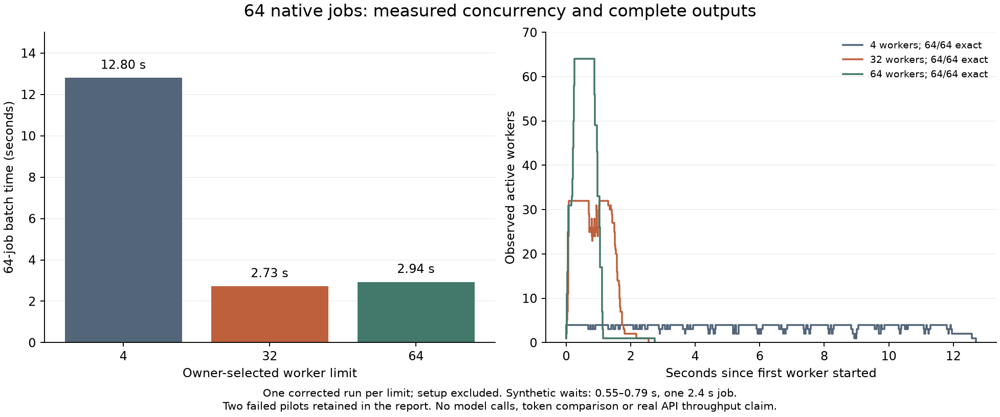

# Configurable workers on the installed native app

Recorded 2026-09-22 on macOS 26.6.2 ARM64, Apple M4 with 10 CPUs and 16 GiB RAM.
The tested 0.2.0 development app lets its owner select **1–64 simultaneous jobs**
in **Settings → Execution**. The default remains four. Separate limits constrain
local scripts and individual named connections; queued work starts as capacity
becomes available. Limits apply across assignments on this device.

## Observed capacity

The final corrected fixture returned **192/192 complete exact outputs**: 64 jobs
at each limit. Worker timestamps and live owner status independently observed
peaks of 4, 32 and 64. At limits 4 and 32, new work started before the long first
job finished. This verifies continuous refill rather than slowest-member waves.

| Worker limit | Exact outputs | Observed peak | Batch seconds | Setup seconds |
| ---: | ---: | ---: | ---: | ---: |
| 4 | 64/64 | 4 | 12.804 | 0.229 |
| 32 | 64/64 | 32 | 2.731 | 0.180 |
| 64 | 64/64 | 64 | 2.937 | 0.210 |

These are single observations of synthetic waiting jobs. Most wait 550–790 ms;
one waits 2,400 ms. The initial workers wait for a coordinator release file, so
the fixture can observe the requested concurrency. Setup precedes the timing;
CLI status sampling and MCP inspections are inside it. The 32-worker run was
faster than the 64-worker run on this workload. This does not establish a best
setting, CPU throughput, provider rate limits, client latency or token savings.

The [frozen protocol](fixtures/worker-capacity/protocol.json),
[metrics](fixtures/worker-capacity/metrics.json),
[relative worker intervals](fixtures/worker-capacity/intervals.json),
[CSV](fixtures/worker-capacity/metrics.csv),
[editable chart](fixtures/worker-capacity/worker-capacity.svg) and
[chart provenance](fixtures/worker-capacity/chart-provenance.json) are retained.
The [measurement helper](../../tools/evals/measure_continuous_pool.py) creates
fresh private state and never accesses normal accounts. Exact checks include
every keyed payload, Unicode, whitespace, newlines, numbers, null and booleans.
Each final store has 64 successful effects, zero billing calls, and passing
SQLite integrity and foreign-key checks.

## Failed pilots remain part of the record

The first pilot supplied a relative marker path. Its first four workers failed
under their isolated working directories, leaving four uncertain effects. The
helper now resolves its output directory before preparing worker inputs.

The second pilot passed at 4 and 32 workers, but the 64-worker gate timed out.
All 64 intents were dispatched within 466 ms; only 63 start files appeared.
The precise reason for the missing start file is unknown. Each worker had been
repeatedly scanning the shared directory. The final amendment moved counting to
the coordinator and made each worker poll one release file; all three limits
then passed in new state. No failed intent was retried or reconciled.

Across all pilots and the corrected run, 320 native effects succeeded and 68
remained uncertain. There were no provider calls. The table and chart identify
the corrected protocol, rather than presenting the earlier failures as passes.
The [amendment](fixtures/worker-capacity/amendment.json) retains their hashes and
the boundary between observations and suspected causes.

## Controls and native verification

The owner can select presets 4, 8, 16 or 32, or a custom value through 64. A
separate local-job limit defaults to four: raising only the total does not raise
Python concurrency. Per-connection caps use exact binding names across
assignments; aliases for the same provider are not automatically grouped.
Provider quotas and lower recipe limits still apply. Reducing a limit drains
already admitted work. Policy changes never grant new operations or credentials.

The mounted Tauri app passed native save/reload checks for total/local limits
32/8 and 64/16, plus a connection limit of three. It rejected 65, rejected a stale
policy revision, and reloaded an owner edit. The installed app subsequently
displayed the preserved default 4/4 policy. MCP exposes scoped read-only worker
status; agents cannot change owner limits.

Required checks passed: formatting, strict workspace and native Clippy,
**410 default Rust tests**, **453 fault-injection tests**, **46 UI tests**, and
full-schema documentation validation. Both Rust suites retained one existing
ignored test. The focused connector test configuration passed 65 tests. Targeted
checks cover 64-child one-call completion, lower limits, concurrent cancellation,
revocation, budgets, crash uncertainty, live attempt leases, stale policy writes,
assignment privacy, and OAuth refresh serialization with credential replacement
checks. Existing downgrade fixtures were updated for the new schema table; test
assertions and runtime security controls were preserved.

The continuously refilled native/API pool is bounded at 64. Pure/control work and
optional model-sampling work remain serial. This is a local device scheduler,
not distributed execution. A worker is one admitted operation; many recipes can
queue, and a recipe may itself contain several parallel operations.

## Package and installation identity

Runtime source: `78c28d08403fc1261078cbe8d7c71d10b6617c75`. The build includes
optional Jev. Later evaluation helpers, reports and exports do not change the
tested executable. The [candidate record](fixtures/worker-capacity/candidate.json)
retains its identities and native validation.

| Artifact | SHA-256 |
| --- | --- |
| `CookBook APR_0.2.0_aarch64.dmg` | `91a24a46590236042395388c25b28c69627a862d330635239a7a67a597c41607` |
| APR sidecar | `779e75c0b17038e0f9d4a317068a5d3127d15ebecff3cc69574cacd0af273781` |
| Desktop executable | `e9b3da13280bcadeadfcae04bea2f527d8c76d7ffbd33268f91fe7a5907b1778` |

The DMG passed verification and the mounted app passed strict deep signature
verification. Signing used the already approved local development identity;
there was no production signing or notarization. The actual mounted app was
exercised with disposable state before installation.

The prior app and private runtime were backed up. Installed binaries match the
mounted package. Migration to schema 18 added the worker-policy table while
preserving every existing table's rows, all six accounts, ten grants, the private
credential file and selected workspace. Old uncertain provider runs were left
untouched. Subsequent synthetic provider evaluations have separate new records.

Actual client and provider outcomes belong to the
[README candidate evaluation](2026-09-22-readme-candidate.md). Capacity checks
alone do not pass those launch gates.
