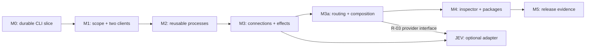

# Complete implementation plan

## Prepared MCP calls — 2026-11-19

Keep scope and request identity intact through the existing MCP bridge. Add
opt-in projections for the complete recipe values or the saved-run receipt.
Prompt connected clients to call known recipes directly. Exercise both natural
language and already-typed inputs using the installed client connection model.

## Prepared profile batch — 2026-11-19

Use an empty JSON Pointer for v0.2 scalar item keys and reuse the runtime's
existing key validation, ordering, worker limits, and replay semantics. Build a
synthetic profile lookup that accepts an email list and returns a complete ordered
list through the existing compact MCP response.

## Agent capability and workflow-design guidance — 2026-09-23

1. Expose use-case-to-capability routes through the existing overview and a
   bounded `workflow_design` guide, without adding tools or authority.
2. Route the skill and authoring/review guides to that material. Preserve the
   fast path for known recipes and remove conflicting connection-discovery work.
3. Document migration of execution instructions and observation of work inside
   handoffs, retaining quality and recovery requirements.
4. Check actual guide delivery, route reachability, skill structure and canonical
   docs; run required Rust checks for the additive discovery contract. Record
   source validation separately from packaging, installation and model savings.

## Reference-first workflows and background browser — 2026-09-22

Expose solved-workflow reference material through MCP and the short skill. Retain safe bounded admission reasons and native failure categories without exposing payloads. Complete the Jev observation/policy/branch/artifact example with controlled-provider tests. Add a pinned headless browser scaffold with run-bound private sessions, exact destination checks, single-use observations, one effect per action, lease cleanup and recorded reference actions. Qualify using synthetic direct-reference and registered-runtime runs, then required local checks and a development-signed installer.

Completed with [recorded evidence](../evaluations/2026-09-22-reference-first-browser.md).
The actual redirect probe exposed a destination-check defect; the final helper
refuses redirects before delivery. The final legacy worker envelope remains
unchanged; host-issued run identity travels in a cleared environment variable.
The verified app and owned Codex skill were installed with all saved rows and
credential bytes preserved. Existing client processes require reconnection for
the new embedded guide. No live provider outcome was retried or regraded.

## Configurable continuous workers and README evaluations — 2026-09-22

1. Add strict persisted owner worker policy, stale-revision checks, native settings,
   CLI control and read-only scoped agent/status views; keep defaults at four.
2. Prepare/settle under short coordinator locks, protect active attempts with
   process-safe leases, refill each available slot and drain cleanly on limit
   decreases. Preserve every authority, budget, fence and cancellation boundary.
3. Serialize OAuth credential refresh across processes while allowing ordinary
   same-account API requests to overlap. Replace bounded tree enumeration in
   MCP waits with an authorized aggregate status over the whole admitted family.
4. Verify lower/local/provider limits, fairness, controls, recovery, exact ordered
   results and 32/64-worker behavior. Run required checks, build and exercise the
   mounted native package before updating the installed app with state preserved.
5. Freeze and run fresh README E01/E02 studies plus bounded E03/E04 where current
   approved accounts and recorded spending permit. Run the reviewed E05 control
   set separately; new truth requires its own provenance. Retain all failures,
   setup costs, client/provider usage and raw evidence; publish only supported
   results and charts, with no Actions or production publication.

Completed the implementation, native installation and bounded evaluation runs.
The [capacity report](../evaluations/2026-09-22-worker-capacity.md) records passed
engineering checks and retained failed pilots. The
[README report](../evaluations/2026-09-22-readme-candidate.md) separates the failed
autonomous setup from successful assisted prepared execution, and records stopped
provider/learning work without retries. Launch claims remain blocked by those
outcomes; no classifier or production recipe was promoted.

## Composed waits and bounded workers — 2026-09-22

1. Extend bounded MCP waiting to runnable child trees, with prompt return for
   actual handoffs, terminal/paused/blocked states and expired wait budgets.
2. Separate external preparation/reservation, execution and result commitment.
   Keep one state coordinator; overlap at most four prepared workers in a bounded
   wave while retaining the existing writer lock and durable attempt fences.
3. Gather ready work fairly across runs, respecting dependencies, foreach limits,
   root budgets and current authority. Track all active cancellation flags and
   retain individual outcomes even when another worker fails or requests input.
4. Test bounded native/API overlap, exact ordered outputs, no duplicate replay,
   limits, interruption/recovery and child handoffs. Run required runtime checks,
   record installed protocol evidence and validate a fresh native package.

All four steps completed, followed by the authorized local installation with
unchanged saved state. The [package comparison](../evaluations/2026-09-22-parallel-batches.md)
retains the frozen protocol, complete outputs, overlap measurements, call/byte
counts and setup separately. Reviews repaired cancellation and settlement races;
the final required checks passed. No live-provider or model-token claim follows.

## Batch execution and reviewed E05 — 2026-09-22

1. Review scheduler, child/foreach dispatch and MCP output behavior; demonstrate
   a bounded JSON job batch through the installed binary with disposable state.
2. Freeze fresh development/held-out expectations and all five E05 candidates;
   require explicit human review bound to the expectation hash before evaluation.
3. Run the controlled evaluator once per cycle, retaining pass/fail/inconclusive
   results and verifying zero effect dispatch. Exercise adoption/rollback only in
   the disposable fixture and check historical run/schedule pins.
4. Record actual batch behavior and E05 outcomes, update current evidence links,
   and commit/push without Actions. No runtime rebuild is needed unless code changes.

The installed checks completed without runtime changes. The batch guide now
distinguishes one input/aggregate output from the missing simultaneous worker
execution, and documents the early `waiting_for_child` return. E05's fresh reviewed
controls produced pass/fail/fail/inconclusive/inconclusive, with fixture adoption
and rollback verified. A final CLI payload mistake was corrected by read-only
retrieval, preserving the original reports and single-evaluation budget.

## Prepared token efficiency — 2026-09-22

1. Apply a fresh version of the approved Codex trust plan; verify the exact managed
   entry/skill and preservation of unrelated settings. Finish the previously
   blocked trust diagnostic under a frozen amendment.
2. Audit actual per-turn token and tool-result evidence. Rank context loading,
   approval/model turns, repeated metadata and intermediate data as separate
   causes; do not infer billed cost from token counts.
3. Make the installed skill a concise entry point into complete on-demand guides.
   Add a compatible result-focused execution option if it measurably reduces
   response overhead, with complete recipe output and existing full inspection.
4. Freeze a bounded multi-step prepared-workflow comparison, permitting equivalent
   direct code reuse and retaining all failures/setup costs. Measure full outputs,
   exact source access, input/cache/output tokens, actual reviews and wall time.
5. Run focused regressions plus required combined checks, build and inspect the
   native package, update the installed app/owned skill with the approved trust
   choice preserved, and record/push implementation and evidence.

The matched normal-project study retained 9/12 exact reuse outcomes, with all
three CookBook Luna failures caused by proof formatting. The valid Sol pair
showed higher token consumption and redundant skill reloads. Implemented strict
semantic proof matching, required workspace schemas and narrower authoring-skill
routing as evidence-driven follow-ups; do not replace the original failed cases.
Native packaging and required checks passed; see the
[token report](../evaluations/2026-09-22-e02-token-efficiency.md).

The installed repair passed a separate four-turn Luna/Sol regression: complete
outputs and page coverage in every case, with one run call and no skill reload or
review on each prepared reuse. Previously exposed cases and absent new direct
controls keep this result separate from comparative savings.

## Complete prepared execution path — 2026-09-22

1. Compact equivalent schema variants and repeated definitions; specialize initialization guidance by available authority.
2. Add an opt-in managed Codex run-tool policy with native preview, default unchanged behavior, stale-plan checks and complete nested configuration ownership hashes.
3. Prepare matched ephemeral conversations with identical output rules; time the first and later reuse turns, retaining setup separately and exact grading.
4. Compare Luna-low directly and through CookBook, plus a stronger model at low reasoning. Freeze cases and policy before execution; no replacement trials or provider calls.
5. Validate the combined change, package and inspect the native update, preserve installed state, and apply live client trust only with explicit owner consent.

Steps 1–4 and local validation/installation in step 5 are complete; see the
[prepared-conversation evidence](../evaluations/2026-09-22-e02-prepared-conversation.md).
Default-policy quality passed, first-reuse speed did not. The native trust choice
was subsequently approved, applied and measured in a separate
[trusted-policy diagnostic](../evaluations/2026-09-22-e02-trusted-prepared.md).
No speedup is inferred from subtracting observed review time; that later run has
explicit timing/context confounders.

## Prepared recipe call overhead — 2026-09-22

1. Reproduce the unnecessary follow-up call with a real service/MCP test.
2. Add a bounded post-acceptance wait, retaining scoped reads and independent execution.
3. Teach known-reference reuse, direct completed-output use and explicit inspection arguments.
4. Validate idempotency, wait bounds, caller handoffs, failures and response limits; then measure fresh prepared cases with setup excluded.
5. Package/install the verified update while preserving state, credentials and uncertain effects.

## Local credentials and Python access — 2026-09-22

1. Add a bounded private TOML store with atomic locked writes and no implicit OS-vault fallback.
2. Add explicit owner migration with revision revalidation, metadata-only status and backup exclusion.
3. Add native interpreter review, hash-checked approval and idempotent grant reuse; preserve changes/revocations as dispatch blockers.
4. Validate affected boundaries, required Rust checks, and the packaged native flow. Preserve all installed state and record any one-time OS consent still required for old keys.
5. Support explicitly selected local macOS development signing without publisher credentials or notarization. Preserve stable app/runtime identifiers, verify the actual package, and keep disposable projects outside protected user folders.


## Connection compatibility completion — 2026-09-22

Include owner-reviewed saved-account reuse for native adapter updates. Keep exact
automatic matching, bind the exception to proposal/account/review digests, and
verify source-only updates, different destinations/commands, stale/revoked
accounts, repeated approval and preservation of unrelated state. Exercise the
pending-review boundary with synthetic data.

1. Detect a supported MCP version during owner discovery and freeze it before approval.
2. Select exact-issuer public registrations, advertised hosted identity, or dynamic registration; prepare static hosting without publishing it.
3. Ship a bounded pinned adapter scaffold and installed guide; retain separate owner approval.
4. Exercise focused connector/runtime/UI cases, a real agent journey and a fresh native package.
5. Record synthetic versus live route coverage, preserve installed state, and commit/push the reviewed implementation. Hosting and external publication require the owner's approval.

## Wrapper-replacement examples and delegated connection preparation — 2026-09-21

1. Lead README examples with callable multi-step operations and useful output contracts.
2. Extend installed MCP/skill guidance with route selection, tested API/CLI adapter preparation, protected credential boundaries and precise readiness reports.
3. Record standard-client identity/version negotiation, richer API transport and adapter ergonomics as concrete remaining work in the [coverage plan](connection-coverage.md).
4. Check installed guide completeness and managed skill compatibility; build matching native/sidecar guidance and preserve local state during the authorized update.


## Simple connections and first-launch scope — 2026-09-21

1. Promote Connect a service with automatic public OAuth discovery and a native key field.
2. Persist remote bearer/header accounts before discovery; retry without re-entering keys, retain exact contract/revision checks and separate operation approval.
3. Exercise all supported key headers, failed discovery/restart, stale/revoked selections and browser cancellation; inspect the real packaged native form with disposable state.
4. Publish accurate support limits and make launch acceptance maintainer-run. Keep broader provider economics, participant studies and platform expansion separate.


## Generic connection authorization — 2026-09-21

Registration-default repair: prefer advertised Basic over POST, preserve strict
returned-metadata validation, and explain rediscovery for stale reviewed methods.
Test the combined discovery/registration seam and existing callback/refresh paths;
verify public live registration without authorizing an account.

1. Expose `connection_contract` in MCP and public-only `connection.discover` in author mode.
2. Support advertised OAuth registration, PKCE and protected client credentials/refresh without provider branches.
3. Migrate to independent saved accounts; enforce separate operation approvals, sharing, revocation and restore.
4. Render exact credential labels and compatible account choices in native approval; keep legacy requests identifiable.
5. Verify scoped protocol, synthetic OAuth servers, account lifecycle and disposable native package; preserve the installed state during the authorized update.

## Recipe improvement and cookbook design — 2026-09-21

1. Reuse retained run/attempt/billing evidence for bounded scoped summaries;
   expose missing quality, cost, caller context and human effort as unknown.
2. Persist stable cycle/proposal/policy/dataset/candidate/report identities;
   reject conflicting retries, overlap, changed policy and stale selection.
3. Run supported pure recipes against frozen cases in a permission-free disposable
   runtime; block unsupported effects before dispatch. Gate complete outputs and
   declared quality/benefit. Preserve holdout labels from ordinary status views.
4. Expose scoped MCP/CLI and an on-demand installed guide, with a concise
   read-only native report. Explicit adoption selects future work only.
5. Replace generic panel-heavy styling and the old icon with a coherent cookbook
   visual system, preserving keyboard navigation and readable failure states.
6. Execute required Rust/doc checks, affected UI/packaging checks and the actual
   packaged app against disposable state. Record limitations with the evidence.

## Optional classifier learning — 2026-09-21

Ship three reusable manifest 0.2 recipes through an on-demand MCP guide. Implement
bounded pure collection/proposal/evaluation helpers and scoped retained-run paging;
reuse caller handoffs, frozen configuration, protected Jev calls and ordinary
immutable registration. Do not add a parallel learning database or weaken visual
Jev tuning. Update skill routing and user instructions. Finish with scoped tests
and fresh local development packages. See [the contract](../architecture/classifier-learning.md).

## Agent-created projects and computer-use updates — 2026-09-21

Replace mandatory per-project setup with one user-level Codex/Claude connection.
The agent proves current-folder write access, creates/reconnects its workspace,
and includes its explicit handle on every MCP call. Preserve fixed attachments,
revocation, owner grants and concurrent-project isolation. Validate with disposable
homes/state and the fresh native package. Add an immutable, review-only upstream
computer-use checker; updating the adapted worker remains a reviewed source change.
No automatic execution/replacement of downloaded code or saved recipes.


## Recipe/desktop extension — 2026-09-17

On the implementation branch, recipe-author payload/cost analysis, scoped connection proposals, trusted owner approvals, outbound tools-only MCP, and the Tauri desktop now extend the earlier inspector. [Current architecture](../architecture/recipe-connections.md) and [desktop runbook](../runbooks/desktop.md) supersede earlier statements that all of those surfaces are deferred. Workflows are branded **Recipes**; wire identifiers stay compatible. Source presence is not release evidence: consult the validation log for actual checks. OAuth login/refresh, Windows, signing, general visual building, invoice reconciliation and hard monetary caps are not implied.

2026-09-16. **Delivery plan; local implementation status is maintained in [the tracker](task.md).** The [computer-use and scheduled-jobs extension](computer-use-and-schedules.md) adds CU-01–04 and SJ-01–04 to the original work packages below. [Runtime validation](../logs/runtime-validation.md) records executed evidence. This document owns work packages, dependencies, and delivery sequence; linked architecture documents own runtime behavior. Every path, command, feature, and release below that is absent from the repository is proposed.

## Intended result

Deliver a local Rust runtime that lets Codex and Claude Code author, discover, configure, compose, execute, inspect, and resume reusable processes within an authorized project and assignment. Support deterministic operations, independent connections, and durable requests to the current agent. Deliver a usable CLI/MCP installation first and an optional desktop inspector afterward.

General routing is part of the product: choose among processes, branch within them, run independent children concurrently, and pause for unfamiliar work. Jev is an optional adapter. The core, rules-based routing, caller handoffs, examples, and normal CI must work without any inference-provider account. No task except the explicitly marked Jev evaluation depends on Jev access.

The repository is public. Licensing remains an owner decision; publication has not selected a software license. Plan the contribution and distribution work explicitly rather than treating a public repository as a finished open-source release.

## Reading and implementation discipline

Read [product requirements](../specs/product.md), [runtime](../architecture/runtime.md), [protocol](../architecture/protocol.md), and the architecture relevant to the selected work package. For provider/routing changes also read [decision providers](../architecture/decision-providers.md) and [composition](../architecture/workflow-routing.md). The [verification plan](verification.md) defines the acceptance evidence.

Work on one end-to-end slice at a time. Each work package should become one reviewable change or a small numbered series. Include implementation, meaningful tests, affected contracts/docs, and recovery behavior in that change. A package is complete only when its stated evidence exists. Mark work blocked by credentials or missing clients separately from completed local tests.

Keep normal development account-free. Use temporary state directories, synthetic artifacts, a controllable clock/ID source, and a local fake connector. Make effect dispatch and commit points injectable for crash testing. Tests should exercise the real store/scheduler interfaces; fake only external services, clocks, and worker behavior where necessary.

## Dependency graph and delivery stages



JEV does not gate M4 or M5. Connector work can begin after M1 once its contracts are stable, but integrate it after the M2 executor and artifact tests. UI implementation waits for the service interface; early UI work may only refine the existing mockup.

| Delivery | Required work | Claims allowed after verification |
|---|---|---|
| Public design, completed | Specifications, examples, mockup, documentation checks | Design available for review; implementation status is recorded separately in the tracker |
| Core alpha | M0–M1 | A small durable fixture runs through each tested client |
| Workflow beta | M2–M3a | General bounded processes, brokered operations, and composed routing work on the tested platform |
| Desktop preview | M4 | Fresh installation, inspector, updates, and supported Linux core work |
| Stable release candidate | M5 | Published scope and compatibility backed by recorded tests, benchmarks, and support procedures |

Runtime package versions, wire protocol versions, manifest versions, local database migrations, and adapter versions are separate. Assign package release numbers when the corresponding gate passes. Current admission supports manifest 0.2 and legacy 0.1; scheduled jobs use database migration 9 without changing the process-manifest version.

## Code organization

Start with three Rust crates: `apr-core`, `apr-runtime`, and `apr-cli`. Put storage, scheduling, artifacts, IPC, and executors in internal modules of `apr-runtime`; split a crate only when compilation, ownership, or an optional dependency justifies it. Add `apr-mcp` when M1 starts. Later, the Jev adapter and Tauri app are optional packages/features. The [runtime module interfaces](../architecture/runtime.md) are authoritative.

Proposed source layout:

```text
crates/apr-core/src/          domain types, admitted plans, transitions, policy
crates/apr-runtime/src/       store, artifacts, engine, workers, IPC, broker
crates/apr-cli/src/           command parsing, installation, diagnostics
crates/apr-mcp/src/           four tools and optional authoring dispatch
crates/apr-provider-jev/      optional compiled provider adapter
apps/inspector/               optional Tauri shell and local frontend
integrations/shared/         canonical inline skill and capabilities
integrations/codex/          generated wrapper + installer contract tests
integrations/claude/          generated wrapper + installer contract tests
tests/fixtures/              synthetic process/input/provider scenarios
tests/integration/           persistence, service, scope, connector behavior
tests/e2e/                   real client and packaged-install scenarios
benchmarks/                  reproducible workloads and result metadata
```

The four Rust crates and the manual integration assets now exist; other directories are planned. Avoid empty scaffolding for future modules. The toolchain pin, minimum supported Rust version, Cargo.lock, and selected dependency features are committed. Keep Tauri/Node and model SDKs out of the core installation.

## M0 — executable durable slice

Entry: current design and no runtime. Exit: a CLI fixture creates a run, pauses, survives restart, accepts a supplied result, and produces the expected artifact without repeating committed work.

| ID | Work and deliverable | Depends on | Completion evidence |
|---|---|---|---|
| M0-01 | Create the three-crate workspace, pin dependencies/toolchain, establish formatting/lint/build and documentation CI. Qualify JSON Schema support and define a versioned canonical encoding for digests. | Design | Fresh checkout builds with locks; exact tool versions and digest fixtures recorded. |
| M0-02 | Implement manifest parsing and the admitted-plan type for the supported built-in/agent subset; validate inputs, dependencies, bindings, effects, finite limits, and immutable bundles. Explicitly reject unsupported operations. | M0-01 | Bad references, cycles, extra fields, invalid bounds, unsafe retry declarations, and changed bundled code are rejected with paths. |
| M0-03 | Add SQLite migrations, transaction helpers, run/step/attempt/receipt records, revision checks, and event cursors. Define request and result digest inputs. | M0-01 | Same request key returns the same run; conflicting input fails; concurrent submissions commit one accepted outcome. |
| M0-04 | Implement snapshot import, content hashes, scoped artifact metadata, bounded reading, atomic object publication, and deterministic packaging. | M0-02, M0-03 | Corrupt/missing files block use; equivalent packages have equal hashes; a crash cannot leave a committed missing object reference. |
| M0-05 | Implement finite scheduling, leases/fencing, built-in dispatch, run-state reduction, and restart recovery. Store owns transactions; engine owns eligibility. | M0-02–04 | Forced process termination before/after each commit recovers the same logical work; stale workers cannot overwrite a newer attempt. |
| M0-06 | Add saved agent requests, claim generations, schema validation, artifact provenance, resume receipts, and duplicate-submission behavior. | M0-04, M0-05 | A handoff survives restart; duplicate success is replayed; stale/conflicting results fail without regenerating output. |
| M0-07 | Expose minimal CLI start/inspect/resume and build the acceptance fixture; measure startup/idle resource use and document the build-versus-extend decision. | M0-05, M0-06 | A reproducible script drives the real CLI through restart and hash checks; measurements and engine tradeoff are recorded. |

The M0 fixture is synthetic local data preparation plus a manually supplied structured review result. It needs no MCP, Python worker, UI, cloud service, image tool, or Jev. A working slice is evidence for proceeding, not proof of arbitrary process support or scope enforcement.

## M1 — service, authoring, and client integration

Entry: M0 recovery passes. Exit: both clients can perform the same discover/author/run/handoff/resume journey, while their independent work survives MCP teardown.

| ID | Work and deliverable | Depends on | Completion evidence |
|---|---|---|---|
| M1-01 | Move run ownership to an on-demand local service; add private IPC, one-supervisor locking, version handshake, bounded requests, and graceful shutdown. | M0 | Two startup attempts converge on one supervisor; stopping a bridge does not stop independent work. |
| M1-02 | Implement projects, attachments, assignments, grants, closure, direct-ID checks, and revocation at dispatch. Add trusted local setup for author/run modes. | M1-01 | Separate assignments cannot read or act on each other's records, events, artifacts, or pending requests. |
| M1-03 | Implement catalog import/discovery, draft validation/testing/registration, immutable promotion, ordinary config precedence, and override schemas. Preflight executes no process code; fixture execution uses explicit run grants and test bindings. | M0-02, M1-02 | An agent-authored fixture can be admitted and reused; tests cannot silently enable paid operations; edits and promotions preserve existing run versions and grants. |
| M1-04 | Implement discover/run/inspect/resume MCP handlers and optional manage dispatch using the same service commands as the CLI. Add paging and output caps. | M1-01–03 | Transport contract tests cover errors, truncated results, reconnect, cursor scope, and idempotent starts/results. |
| M1-05 | Write the canonical inline skill and handoff instructions. Preserve assignment/run identity; treat documents and provider output as task data. | M1-03, M1-04 | Skill fixtures cover reuse, authoring, missing tool, interruption, and returning actual observed artifacts without private client internals. |
| M1-06 | Implement Codex detection, project-scoped setup preview/merge, ownership backups, portable versus device-local config, diagnostics, and uninstall. | M1-04, M1-05 | A tested Codex version completes the real journey; trust denial and absent native capabilities produce useful blockers. |
| M1-07 | Implement the equivalent Claude Code adapter and shared conformance scenarios. | M1-04, M1-05 | A tested Claude Code version completes the real journey; unrelated settings survive setup/update/uninstall. |
| M1-08 | Exercise cross-client claim transfer, two tasks in one directory, worktrees, client restart, paths with spaces, and client policy restrictions. | M1-06, M1-07 | Exact client/OS/adapter versions and observed outputs are recorded; claims cannot transfer by cwd or task title alone. |

Use a broadly available file or structured-reasoning tool for the shared fixture. Test image generation separately only where an actual tool exists. Connection files and mock transport tests do not close M1-06 or M1-07.

## M2 — practical reusable processes

Entry: M1 supports one admitted process and real handoffs. Exit: multiple domains use the same bounded executor and artifact system.

| ID | Work and deliverable | Depends on | Completion evidence |
|---|---|---|---|
| M2-01 | Extend validation to the full supported baseline manifest, typed final outputs, optional defaults, schema references, and negotiated executor features. Disable remote schema fetching during validation. | M1-03 | A fixtures suite rejects unsupported features and invalid bindings before execution; existing baseline manifests remain explicit about support. |
| M2-02 | Persist bounded foreach expansion, stable item keys/order, per-item checkpoints, concurrency, and aggregate output contracts. | M2-01 | Restart reuses the same expansion; duplicate keys and excessive fan-out fail; one failed item does not replay completed siblings. |
| M2-03 | Add the opt-in trusted Python worker: absolute interpreter, locked dependencies, explicit setup, fresh environment, argument arrays, process groups, and bounded streams. | M2-01 | Timeout/kill/output-limit behavior is tested; host access limitations are visible; runtime execution cannot silently install dependencies. |
| M2-04 | Add artifact manifests/validation/bundles, imported-result provenance, disk quotas, orphan cleanup, and retention roots for waiting/running work. | M0-04, M2-02 | Disk-full, interrupted import, corrupt hashes, symlink changes, and cleanup races preserve referenced inputs/results. |
| M2-05 | Implement pause/continue/cancel/retry/reassignment consistently across active workers, queued items, and handoffs; cap diagnostics. | M2-02, M2-03 | Concurrent state changes have defined outcomes; cancellation reports remaining effects accurately. |
| M2-06 | Add local reporting, research-preparation and document-review fixtures with explicit caller handoffs. | M2-01–05 | All use common scheduler code, have declared output/quality criteria, and survive interruptions; a missing requested caller capability remains an explicit blocker. |

Keep dependent package creation/revision behind normal process admission. Pure built-ins can run account-free; trusted Python adds an optional interpreter/dependency footprint that benchmarks must include.

## M3 — connections, configuration, and external effects

Entry: stable worker/artifact behavior and scoped service. Exit: narrow brokered operations complete or reconcile with credentials excluded from process-visible data.

| ID | Work and deliverable | Depends on | Completion evidence |
|---|---|---|---|
| M3-01 | Define connector operations, typed input/output, effect classification, destination/resource rules, budget reservation, idempotency, and reconciliation interfaces. Add a controllable local fake service. | M1-02, M2-01 | Fake service can accept a write then lose the response; exact dispatch and billing counters are observable. |
| M3-02 | Implement platform credential storage and trusted entry/rotation/removal; bind named connections without exposing their values to models or generated code. | M3-01 | macOS credential paths are tested; unavailable storage blocks setup rather than saving plaintext. |
| M3-03 | Implement binding revisions, config resolution, account/resource identity, redacted health reports, and revocation before dispatch. | M3-02 | Changing or revoking a binding mid-run cannot silently redirect an operation to another account/resource. |
| M3-04 | Implement effect intents, logical operation keys, async job references, bounded backoff, and explicit reconciliation. Treat metered reads as budgeted external operations. | M3-01, M3-03 | Provider success/response loss, key expiry, duplicate replies, timeout, and cancellation produce the expected saved states. |
| M3-05 | Add destination/redirect controls, serialized-input redaction, size limits, and concurrent operation accounting. | M3-04 | Resource substitution, credential-bearing errors, redirect changes, and sibling budget races cannot escape declared broker policy. |
| M3-06 | Add one small real independent connector through an explicitly configured account and permitted operation. Publish its retry/idempotency limits. | M3-01–05 | Read and controlled-effect journeys match the fake-service contract; absent credentials are recorded as unverified live coverage. |

The first real connector is selected for a narrow, testable operation rather than a large integration catalog. Choosing it is an implementation decision; any spend or external write still follows the user's authorization for that live test. A fake provider proves local machinery, not a particular provider's guarantees.

## M3a — general routing and process composition

Entry: typed step results and effect/budget machinery. Exit: composed workflows run across domains with or without an inference provider.

| ID | Work and deliverable | Depends on | Completion evidence |
|---|---|---|---|
| R-01 | Write the next manifest/protocol schemas for policy gates, branches, calls, joins, skipped states, and typed merged outputs; migrate examples explicitly. | M2-01, M3-01 | New and old version fixtures have explicit support/rejection behavior; unknown constructs are not ignored. |
| R-02 | Implement rules-only decisions, candidate eligibility, catalog snapshots, provider-neutral decision results, and explicit no-match/clarification outcomes. | R-01 | Complete workflows select routes without provider configuration; ineligible/missing candidates are handled before dispatch. |
| R-03 | Implement the decision-provider interface and a deterministic test adapter, plus caller-assisted decisions through normal handoffs. | R-02, M3-04 | All three sources use the same accepted-route contract; missing confidence is not fabricated; budgets and review rules remain runtime-owned. |
| R-04 | Persist decision evidence/policy version and accepted branches; validate skipped outputs and join readiness. | R-02, R-03 | Restart does not re-evaluate a committed decision; a skipped or failed dependency cannot fabricate a successful output. |
| R-05 | Add parent/child run identities, atomic child creation, immutable target versions, typed input/output projection, and artifact ownership. | R-01, M0-03 | Crash after child creation reuses that child; incompatible inputs/outputs and process-call cycles fail admission. |
| R-06 | Implement depth/child/attempt limits, shared budget reservations, parallel fan-out, and propagation of pause/cancel/handoffs/reconciliation. | R-04, R-05, M3-05 | Nested or concurrent runs cannot gain authority or reset limits; waiting children remain inspectable and resumable. |
| R-07 | Implement bounded catalog retrieval and policy evidence, including full eligible sets for small catalogs and measured retrieval for larger ones. | R-02 | Tests distinguish a retrieval miss from a classifier error; unsupported requests can return no-match. |
| R-08 | Add research comparison, operations intake, and software-verification fixtures with typed synthetic inputs; exercise linked replacement runs for new graphs. | R-04–07 | One engine handles all domains and interruption points; replacement runs preserve provenance without silently repeating old effects. |

No live inference is needed to close the engine portion of this milestone. Automatic routes using a model require that model/task policy's separate evaluation evidence. General loops, runtime code mutation, and live graph migration remain outside this contract.

## JEV — optional provider track

Entry: M3 and R-03. This track can be omitted from an entire installation or release. Follow [the provider contract](../architecture/decision-providers.md) and [Jev research](../architecture/jev-integration.md).

| ID | Work and deliverable | Depends on | Completion evidence |
|---|---|---|---|
| JEV-01 | Add an optional compiled adapter/feature excluded from default builds; translate normalized Choice/Score/Noul questions to the verified API. | R-03 | Default dependency graph excludes Jev; feature-enabled builds pass fake HTTP contract tests without credentials. |
| JEV-02 | Implement named binding, projected input limits, model identity/usage recording, strict output validation, deadline/retry accounting, and explicit enablement. | JEV-01, M3 | Enabling the build feature alone creates no request, credential prompt, or network activity; absent configuration blocks only affected steps. |
| JEV-03 | Verify current access, model identifiers, pricing/limits, and data terms; perform a small explicitly enabled live conformance test. | JEV-02, provider access | Store redacted compatibility evidence and actual usage; no inference of live support from mock fixtures. |
| JEV-04 | Run observation-only multi-domain evaluation, tune on separate data, then enable only policies meeting held-out targets. | JEV-03, R-08 | Report wrong routes, missed escalation, retrieval coverage, complete-assignment quality, latency, and accepted-result cost. |

Failure or unavailability of JEV-03/04 never blocks core releases. Do not silently substitute Jev for a caller's native tools, or substitute another paid provider when Jev is unavailable.

## M4 — inspector, installation, and operations

Entry: stable shared service behavior and routing interfaces. Exit: a supported fresh machine can install, attach a client, complete a run, update, and uninstall without losing unrelated data.

| ID | Work and deliverable | Depends on | Completion evidence |
|---|---|---|---|
| M4-01 | Build the optional Tauri inspector from the design system with a TypeScript/React frontend and bundled local assets; use the authenticated local service interface and no duplicate execution engine. | M3a | Service reconnect and stopped/offline states work; headless operation does not require the UI process or Node. |
| M4-02 | Implement setup, process/version inspection, run trees, route evidence, artifact viewing, pending requests, and scope-aware controls. | M4-01 | UI actions target the correct parent/child scope; a resume control never invents an agent result. |
| M4-03 | Add trusted connection/permission controls, bounded event subscriptions, explicit diagnostic export, and keyboard/screen-reader behavior. Constrain native commands and sanitize untrusted artifact previews. | M4-02 | Secrets stay outside agent-visible UI data; artifact content cannot invoke native controls; keyboard, narrow layout, reduced motion, and live-state tests pass. |
| M4-04 | Package macOS core and optional desktop; select/pin signing/notarization and update tooling, checksums, manifests, and install ownership records. | M4-01–03 | Clean-machine install verifies artifact identity, preserves settings, and reports platform/client incompatibility. |
| M4-05 | Validate Linux CLI/service/MCP and the selected secure credential backend; publish the exact tested platform matrix. | M1, M3, M4-04 | Account-free flows work; locked/missing key storage blocks only dependent connections; no plaintext fallback. |
| M4-06 | Implement consistent backup/restore, transactional migration, artifact-integrity checks, retention controls, and explicit failure recovery. | M0-03, M2-04 | Interrupted migration and rollback drills recover documented state; pending-run artifacts survive cleanup. |
| M4-07 | Finish update/uninstall, fresh-machine onboarding, optional autostart, and client plugin packaging if baseline adapters benefit. | M4-04–06 | Upgrade and removal preserve projects/artifacts/settings; state deletion is separate and explicit; no dependency on replaceable plugin caches. |

Use SQLite's supported backup mechanism for database snapshots and copy the referenced immutable artifacts under an explicit snapshot/retention pin. The database alone is not a complete APR backup. Test restore and integrity before advertising recovery. [SQLite backup interface](https://www.sqlite.org/backup.html).

## M5 — evidence and release

| ID | Work and deliverable | Depends on | Completion evidence |
|---|---|---|---|
| M5-01 | Run all required suites in the [verification matrix](verification.md); publish tested versions, known defects, and unsupported optional modes. | M0–M4 | Every A01–A16 criterion links to observed passing evidence for the full release; earlier alpha/beta builds clearly declare their smaller tested scope. |
| M5-02 | Execute matched direct-agent/cold-authoring/reuse benchmarks and available precedent comparisons. | M5-01 | Whole-assignment quality, setup/maintenance, correction effort, time, tokens, and full installed footprint are reported without extrapolated savings. |
| M5-03 | Review scope/credential enforcement and trusted-script disclosures; qualify an isolated backend separately if making isolation claims. | M5-01 | No unsupported security claim appears in product copy, UI, examples, or release notes. |
| M5-04 | Select the license with the owner, check dependency redistribution requirements, document contribution/release ownership, and set up a verified private vulnerability-reporting path. | Owner decision, dependency inventory | License/notice files and tested reporting instructions exist before claiming an open-source release. |
| M5-05 | Produce reproducible release instructions, SBOM/dependency manifest, artifact checksums/signatures, source tags, changelog, support matrix, and recovery documentation. | M4, M5-03, M5-04 | A second clean environment can verify/install the intended package; credential-bearing release jobs do not execute untrusted PR code. |
| M5-06 | Run fresh-user acceptance in both clients, resolve release blockers, and decide release readiness from the evidence. | M5-01–05 | Documented release checklist passes; provider-specific and platform limitations are visible. |

Licensing can be settled earlier; it need not wait for code. Release credentials, signing identities, and live provider accounts stay outside the repository. No stable-release date is promised before M0/M1 expose the actual implementation and integration effort.

## Compatibility, migrations, and release controls

Freeze every admitted process and resolved ordinary config for its run. Changes create a new version. Negotiate protocol/features at connection time and report a useful unsupported-version error before mutating state. A new binary encountering a newer database refuses to open it for writes.

Migration runs under exclusive service ownership: stop new dispatch, record in-flight effect references, capture a consistent snapshot, apply a transactional forward migration, check integrity, and resume. Preserve the prior snapshot until recovery is verified. Binary rollback requires the matching supported database snapshot; it cannot replay remote effects automatically.

Default releases contain core CLI/service/MCP behavior. Python, the inspector, and the Jev adapter are explicit additions with their own footprint and compatibility metadata. The default onboarding flow never asks for a model API key. Publish client templates as inactive examples until installed into a selected trusted project.

Set dependency/toolchain pins in code, not duplicated version numbers across prose. CI checks generated schemas/wrappers against their sources. Version protocol changes deliberately and include upgrade tests from every still-supported stored schema.

## Observability and support

Implement bounded local events using run/step/attempt/operation IDs, with durations, state changes, artifact counts, declared usage, and diagnostic codes. Request bodies, credentials, continuation tokens, and complete conversations are excluded from ordinary logs. A diagnostic export has a preview and explicit selection.

Expose unknown usage as unknown. For costs that cannot be bounded by a provider contract, enforce request/token limits and describe monetary estimates as estimates. No silent paid fallback. A paused run, disconnected client, stopped service, and sleeping device are separate user-visible conditions.

`apr doctor` is read-only by default; a repair is an explicit action. It checks executable selection, service/protocol health, storage access, client configuration, credential-backend availability, and missing optional executors. The [design system](../specs/design-system.md) owns the corresponding copy and controls.

## Principal risks and decisions

| Risk / decision | Implementation response | Gate / owner |
|---|---|---|
| Building an engine duplicates existing work | Prove the smallest durable caller handoff and compare extension cost before broad UI investment | M0-07, maintainer |
| Two clients behave differently | Shared contract suite plus separately observed native client journeys | M1-06–08, adapter maintainer |
| Graph growth makes recovery ambiguous | Freeze versions, use finite DAG composition, and make skipped/join behavior explicit | R-01–06, runtime maintainer |
| Cheap routing causes costly errors | Measure retrieval, escalation, and final acceptance; evaluate each provider/task policy | R-07, JEV-04, M5-02 |
| Generated native code is overtrusted | Label trusted mode; qualify any future isolation backend separately | M2-03, M5-03 |
| Provider dependency leaks into the core | Default build/egress tests and feature/dependency inspection | R-03, JEV-01, verification suite |
| Public source lacks selected reuse terms | Preserve clear license status; owner chooses before open-source release claims | Miguel, M5-04 |
| Signing accounts or live providers unavailable | Continue local implementation; keep live validation/release packages explicitly pending | M3-06, JEV-03, M4-04 |

## Later capabilities with explicit prerequisites

| Extension | Prerequisite | Work required before adding it |
|---|---|---|
| Strongly isolated workers | Measured need after trusted preview | Select JS/Wasm/OS backend, define host imports, test escapes/resource limits, document exact threat model |
| Schedules and background triggers | Durable independent runs and effect limits | Define trigger identity, missed-run/timezone policy, deduplication, cancellation, and account-free local behavior |
| Cross-device live-run transfer | Verified backups and artifact ownership | Paused export, source relinquishment, target claim, integrity/version checks, and local credential rebinding |
| Remote workers / teams | Explicit multi-user authentication and isolation design | Transport authentication, tenancy, authorization, audit, leases, effect ownership, revocation, and deployment operations |
| Windows | Stable Unix core | Named-pipe IPC, process supervision, credential backend, paths, installers, and native acceptance matrix |
| Public process catalog | License/trust/provenance model | Signed/versioned bundles, review, distribution and update policies; importing source never grants authority |
| General cache or live graph migration | Proven baseline reuse and recovery | Exact invalidation/provenance rules, effect exclusions, migration receipts, and crash/reconciliation tests |

These extensions are planned separately from completion of the local product above. They must not become silent dependencies of the core or reasons to postpone its smallest usable release.

## First implementation assignment

Implement M0-01 through M0-03 as the first reviewable sequence, then M0-04 through M0-07. Keep all new code behind the minimal CLI fixture until its restart/result-receipt evidence exists. Update the tracker and validation log with exact commands and outcomes, then proceed to M1. Do not mark later stages complete because their schemas or mockups exist.

## Reusable tools and execution review — 2026-09-21

Complete the owner library across database, protected approval, scoped MCP, CLI and desktop; preserve old grant scope and fail closed on stale revision, revocation and restore. Ship authoring guidance/audit/examples that keep deterministic services inside recipes, with real runtime fixtures for missing access, judgment interruption, replay, large artifacts and context changes. Preserve virtual-environment invocation paths while hashing approved binaries. Package locally with disposable state; keep live accounts and installation replacement separate.
